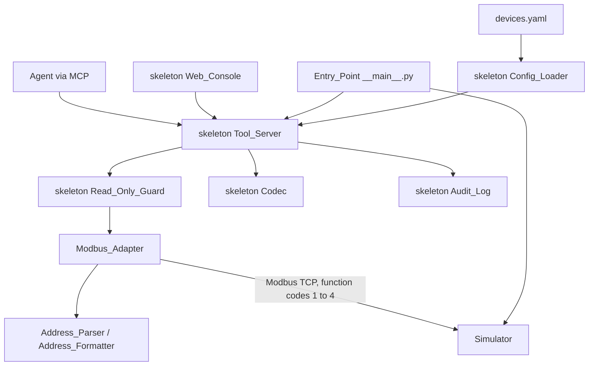
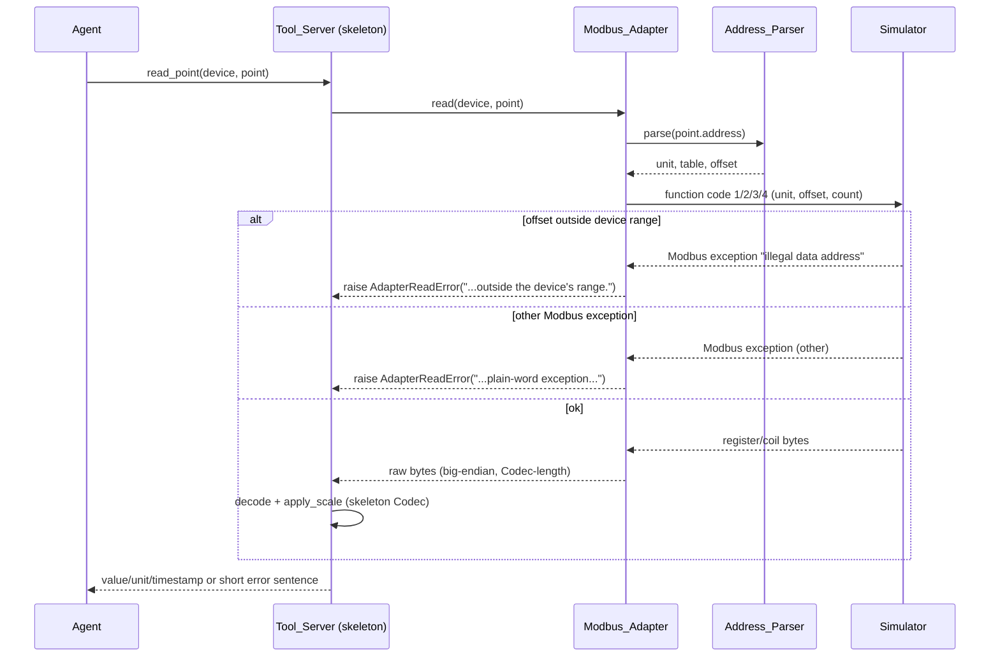

# Design Document

## Overview

The Modbus app plugs a simulated batch mixing line into the Seance skeleton. It lives entirely in `apps/modbus/` and consists of four pieces: a pymodbus-based TCP simulator (`simulator.py`), the only file in the repository that imports `pymodbus` (`adapter.py`), a YAML device description (`devices.yaml`) and an entry point (`__main__.py`) that starts the simulator, the skeleton's `Tool_Server` and the `Web_Console` together behind one command.

The app adds no new public surface to the skeleton. It imports `ProtocolAdapter`, `PointConfig`, `DeviceConfig`, `Configuration`, `HealthStatus`, `load_config`, `build_tool_server` and `serve` exactly as published today. The one skeleton change this app needs — `AdapterReadError`, so the adapter can supply a device- and point-specific failure sentence — is additive and is tracked as its own task against the skeleton-core spec, not against this design. Everything below assumes that exception exists; nothing here changes an existing skeleton signature.

The app's own new code is small and falls into two testable layers:

1. **Address parsing** (`address.py`): pure text-to-structure conversion between `PointConfig.address` strings (`"<unit>:<table>:<offset>"`) and `(unit_id, Table, offset)` tuples. No pymodbus import, no I/O.
2. **The adapter and simulator** (`adapter.py`, `simulator.py`): the only code that speaks Modbus TCP, built on `pymodbus`'s synchronous `ModbusTcpClient` and its `SimData`/`SimDevice` simulator datastore.

## Architecture



Read path for one `read_point` call:



The adapter never retries, never reconnects speculatively beyond what `pymodbus`'s client does internally, and never issues a write function code. Address parsing happens inside the adapter's `read`/`health`, not inside the skeleton, so the skeleton's `Tool_Server` stays protocol-agnostic.

### Layering rules (reaffirmed for this app)

- `apps/modbus/adapter.py` is the only file in the repository that imports `pymodbus`. `simulator.py` also imports `pymodbus` because it is the test/demo device, not a client of the skeleton's `ProtocolAdapter` — this matches Requirement 2.11, which scopes the "only file" rule to the adapter, and the simulator is reused unmodified by the test suite (Requirement 10.1).
- `apps/modbus/adapter.py` imports nothing from `apps/` except `apps/modbus/address.py` (Requirement 2.12).
- `apps/modbus/*` imports only from `seance` (the skeleton) and `pymodbus`; it never imports from `apps/snmp` or any other app.
- No file under `apps/modbus/` calls a pymodbus write method (`write_coil`, `write_coils`, `write_register`, `write_registers`) (Requirement 6.4).

### Startup sequence (Entry_Point)

1. Read and validate `SEANCE_MODBUS_HOST`, `SEANCE_MODBUS_PORT`, `SEANCE_CONSOLE_HOST`, `SEANCE_CONSOLE_PORT` from the environment, applying defaults `127.0.0.1`, `5020`, `127.0.0.1`, `8080`. A non-integer or out-of-range port stops the process with one message naming the variable and the allowed range (Requirement 7.7).
2. Start the Simulator on the Modbus host/port in a background thread. If the port is already bound, stop and print one message naming the port and suggesting `SEANCE_MODBUS_PORT` (Requirement 7.8).
3. Build a `Modbus_Adapter` pointed at that same host/port and call the skeleton's `build_tool_server(devices.yaml, adapter)`, which loads `Configuration`, checks the adapter's four methods and calls `adapter.connect()`.
4. Call the skeleton's `serve(...)`, which starts the `Web_Console` in a background thread and then runs the MCP server over stdio.
5. All logging and startup messages go to standard error; stdio is reserved for the MCP protocol (Requirement 7.9).
6. When the MCP server's `run()` returns (stdio closed), `serve` stops the console and closes the adapter; the Entry_Point then stops the Simulator and exits (Requirement 7.10).

## Components and Interfaces

### `apps/modbus/address.py` — Address_Parser and Address_Formatter

```python
class Table(StrEnum):
    COIL = "coil"
    DISCRETE = "discrete"
    INPUT = "input"
    HOLDING = "holding"


@dataclass(frozen=True)
class ModbusAddress:
    unit: int  # 1..247
    table: Table
    offset: int  # 0..65535


class AddressError(ValueError):
    """Raised with a short sentence naming the bad field and the allowed values."""


def parse_address(text: str) -> ModbusAddress: ...
def format_address(address: ModbusAddress) -> str: ...
```

- `parse_address` splits on `:` and requires exactly three parts (Requirement 3.7); on any other shape it raises `AddressError` with a sentence showing the form `<unit>:<table>:<offset>`.
- Each part is validated independently so the first bad field found is named: unit must be a decimal integer with no leading zero, 1 to 247 (Requirement 3.4); table must be one of the four `Table` values, or the error lists all four (Requirement 3.6); offset must be a decimal integer with no leading zero, 0 to 65535 (Requirement 3.5). Validation order is unit, then table, then offset, matching the order the fields appear in the text, so the message always matches the leftmost problem.
- `format_address` renders `f"{unit}:{table.value}:{offset}"`, the exact inverse of a successful parse. Since `parse_address` rejects leading zeros, the only texts that round-trip are already in canonical form, which keeps the round-trip property (Requirement 3.3) total over the *valid* input space without needing a canonicalization step.
- `ModbusAddress` and `Table` are the only new types this app introduces beyond what the skeleton already defines; they are plain, immutable, hashable dataclasses/enums with full type hints and no `Any`, consistent with Requirement 10.6.

### `apps/modbus/adapter.py` — `Modbus_Adapter`

```python
class ModbusAdapter:
    def __init__(self, host: str, port: int) -> None: ...

    def connect(self) -> None: ...
    def close(self) -> None: ...
    def read(self, device: DeviceConfig, point: PointConfig) -> bytes: ...
    def health(self, device: DeviceConfig) -> HealthStatus: ...
```

- Implements the four `ProtocolAdapter` methods only; it defines no write method anywhere, satisfying Requirement 2.2 structurally (there is nothing to call).
- `connect`/`close` wrap one `pymodbus.client.ModbusTcpClient(host, port, timeout=...)`; `connect` calls `client.connect()`, `close` calls `client.close()` (Requirement 2.9, 2.10).
- `read(device, point)`:
  1. Calls `parse_address(point.address)`. A parse failure is programmer/config error territory already caught at startup (see Requirement 4.9 below), so at read time it is re-raised as `AdapterReadError` naming the point and the reason, as a defensive second check.
  2. Checks that `point.data_type` fits `address.table` (`bool` only fits `coil`/`discrete`; `int16`/`uint16`/`uint32`/`float32` only fit `holding`/`input`) and raises `AdapterReadError` naming the point, the data type and the table otherwise (Requirement 3.8).
  3. Computes `register_count = required_length(point.data_type) // 2` for register tables, or bit `count = 1` for coil/discrete tables (via `seance.codec.required_length`, imported from the skeleton — not a protocol library).
  4. Dispatches to `client.read_coils`, `client.read_discrete_inputs`, `client.read_holding_registers` or `client.read_input_registers` (function codes 1, 2, 3, 4 respectively; Requirement 2.4), passing `device_id=address.unit`, `address=address.offset`, `count=register_count_or_1`, and the device's `timeout_seconds` (Requirement 2.8).
  5. On `result.isError()` (pymodbus's unified error signal for a Modbus exception response — see "pymodbus client response handling" below), inspects the exception code: `IllegalAddress` maps to an `AdapterReadError` stating the address is outside the device's range (feeds Requirement 5.1 through the skeleton change); any other exception code maps to an `AdapterReadError` stating the exception in plain words (feeds Requirement 5.2). Neither message includes a pymodbus class name or a stack trace (Requirement 5.4).
  6. On success, converts `result.bits` (coil/discrete) or `result.registers` (holding/input) into the big-endian byte length the skeleton's `Codec` expects for `point.data_type` (one bit packed into one byte 0x00/0x01 for `bool`; each 16-bit register packed big-endian and concatenated high-word-first for 32-bit types, matching `Register_Word_Order`). This byte conversion is the only place the adapter touches word order, and it is exercised directly by Property 2 below.
- `health(device)`: reads the device's first configured point using the same path as `read`. `ok` if the read succeeds; `degraded` if the simulator answers with a Modbus exception; `unreachable` if the call raises a connection-level error (socket/timeout) rather than returning an exception response (Requirement 2.7). This distinguishes "device answered, but with a fault" from "device did not answer" using exactly the two outcomes pymodbus's synchronous client exposes: an exception *response* (`result.isError()`) versus a connection exception/timeout raised by the client call itself.
- No method on `ModbusAdapter` is ever called by the skeleton's `Tool_Server` with a write intent; the class simply has no such method to call (Requirement 2.2, 6.4).

### `apps/modbus/simulator.py` — `Simulator`

- Built on pymodbus's simulator datastore (`pymodbus.simulator.SimData`, `SimData`, `SimDevice`) and `pymodbus.server.StartAsyncTcpServer` (or the synchronous `ModbusTcpServer` run on a background thread, since the rest of the app is synchronous — see "Research" below for the chosen approach).
- One `SimDevice` per unit id (mixing tank, feed pump, chiller), each with four register blocks (coil, discrete, holding, input) built from `SimData` entries matching `devices.yaml` one for one, so the simulator's memory is the single source of truth the adapter reads from and property tests compare against (Requirement 2.6).
- A background thread calls an `action` callback (pymodbus's per-`SimDevice` register-access hook) or a dedicated drift thread that, at least once per second, nudges each analog value by a small bounded random step clamped to its configured `[min, max]` (Requirement 1.5, 1.6). The random generator is seeded from a constructor argument so that two `Simulator` instances built with the same seed produce the same sequence (Requirement 1.7).
- When the mixing tank's level value drifts below its configured low limit, the drift step also sets the mixing tank's low-level discrete input bit (Requirement 1.8).
- Requests addressing an undefined table offset or using a function code outside 1-4 receive pymodbus's own exception responses (`illegal data address`, `illegal function`) without any custom code in `Simulator`, because the pymodbus simulator datastore already raises these for addresses/function codes it was not configured with (Requirement 1.9, 1.10).
- `Simulator.stop()` releases the TCP port and joins the drift thread with a bounded wait, returning within 2 seconds (Requirement 1.11).
- `Simulator.function_codes_seen` (a thread-safe counter) records every function code it receives, for Requirement 6.1/6.2's tests; this is test-support surface, not used by the adapter or the entry point.

### `apps/modbus/config.py` — thin wiring, not a second config loader

There is no second config loader. `devices.yaml` is read with the skeleton's `load_config` exactly as published. `apps/modbus/__main__.py` additionally calls `parse_address` on every configured point's `address` at startup and stops with one message naming the device, the point and the reason on the first invalid address (Requirement 4.9) — this check belongs to the app, not the skeleton, because only the Modbus app knows what a valid `Modbus_Address` looks like.

### `apps/modbus/__main__.py` — Entry_Point

- Implements the startup sequence above. Contains no business logic beyond environment parsing, wiring and ordering; the simulator, the adapter and the config loader each own their own validation.
- Reads `SEANCE_MODBUS_HOST`/`PORT` and `SEANCE_CONSOLE_HOST`/`PORT` with the documented defaults (Requirements 7.2-7.5).
- Needs no secret and makes no network call beyond `127.0.0.1` by default (Requirement 7.6).

## Data Models

```python
class Table(StrEnum):
    COIL = "coil"
    DISCRETE = "discrete"
    INPUT = "input"
    HOLDING = "holding"


@dataclass(frozen=True)
class ModbusAddress:
    unit: int
    table: Table
    offset: int


class AddressError(ValueError):
    def __init__(self, field: str, reason: str) -> None: ...
```

No new dataclass is added to the skeleton. `PointConfig`, `DeviceConfig`, `Configuration`, `DataType` and `HealthStatus` are used exactly as defined in `skeleton/seance/points.py` and `skeleton/seance/adapter.py`. `devices.yaml` stores the `Modbus_Address` as the plain string in `PointConfig.address`; `ModbusAddress` only exists transiently inside `address.py` and `adapter.py`.

## Research

**pymodbus synchronous client and its response contract.** The synchronous `ModbusTcpClient` exposes one method per function code (`read_coils`, `read_discrete_inputs`, `read_holding_registers`, `read_input_registers`), each taking `address`, `count` and `device_id` (the current parameter name for what used to be called `slave`/`unit`), and each returning a unified response object: `result.isError()` is `True` when the device returned a Modbus exception response (e.g. illegal data address, illegal function), and `result.bits` / `result.registers` hold the decoded values on success. A connection-level failure (refused connection, timeout) raises rather than returning an error result. This is exactly the split the design uses to distinguish `AdapterReadError` (device answered with an exception) from `unreachable` health / timeout (device did not answer). [PyModbus client docs](https://pymodbus.readthedocs.io/en/latest/source/client.html)

**pymodbus simulator datastore (`SimData`/`SimDevice`).** The 3.x simulator datastore defines named, typed register groups (`SimData(address, count, values, datatype)`) grouped into one or more `SimDevice(id, simdata)` entries, with automatic conversion between typed values (`INT16`, `UINT16`, `INT32`, `UINT32`, `FLOAT32`, `BITS`, ...) and the underlying 16-bit registers. A `SimDevice` can use four separate blocks (`(coils, discrete_inputs, holding, input)`) instead of one shared block, which matches this app's need for genuinely separate coil/discrete/holding/input tables per device. Register addresses the simulator was not configured with answer with pymodbus's own exception response, so the simulator needs no custom "illegal address" handling. [PyModbus data model docs](https://pymodbus.readthedocs.io/en/latest/source/simulator/datamodel.html)

**pymodbus server startup.** `pymodbus.server.StartTcpServer(context, address=(host, port))` runs a synchronous-style threaded TCP server (`ModbusTcpServer` under an asyncio loop managed internally); it blocks, so the `Simulator` wrapper runs it on a dedicated thread and stops it through pymodbus's documented `ServerStop()`/async shutdown path, joined with a timeout to meet the 2-second stop requirement. [PyModbus server docs](https://pymodbus.readthedocs.io/en/latest/source/server.html)

**Word order for 32-bit types.** The skeleton's `Codec` is a fixed big-endian codec per `DataType`, with 32-bit types occupying 4 bytes. Requirement 1.4 and the glossary's `Register_Word_Order` fix the convention for this app at the adapter boundary: two 16-bit pymodbus registers, high word first, each register itself big-endian — so concatenating `registers[0]` then `registers[1]`, each packed with `struct.pack(">H", r)`, produces exactly the 4 bytes the skeleton's `Codec.decode(UINT32 | INT32 | FLOAT32, raw)` expects. This is a convention this app chooses and documents (word order is configurable per device in real Modbus gear, but this app fixes one order, as stated in the requirements), not something pymodbus enforces.

## Correctness Properties

*A property is a characteristic or behavior that should hold true across all valid executions of a system — essentially, a formal statement about what the system should do. Properties serve as the bridge between human-readable specifications and machine-verifiable correctness guarantees.*

### Property 1: Address round-trip

For any valid `ModbusAddress` (`unit` 1-247, `offset` 0-65535, any `Table`), formatting it to text and parsing that text back returns the same `unit`, `table` and `offset`, and formatting the parsed result returns the original text.

**Validates: Requirements 3.3**

### Property 2: Adapter reads match the simulator's memory

For every supported data type and every value the Simulator holds for a configured point, the value produced by decoding and scaling the bytes the `Modbus_Adapter` returns from `read` equals the value obtained by decoding and scaling the same bytes read directly from the Simulator's backing store for that point.

**Validates: Requirements 2.6, 7.12**

### Property 3: The Simulator observes only read function codes

For any sequence of tool calls made through the `Tool_Server` against the Modbus app (including calls carrying a write tool name or a write argument set), every function code the Simulator records is one of 1, 2, 3 or 4, and a call that the skeleton's guard rejects causes the Simulator to receive zero requests for that call.

**Validates: Requirements 6.1, 6.2, 6.3**

### Property 4: Invalid address text is rejected with a field-naming sentence

For any address text that is malformed in exactly one of these ways — not exactly three colon-separated parts, a unit outside 1-247, an offset outside 0-65535, or a table outside the four allowed names — `parse_address` raises `AddressError` whose message names that specific field and its allowed values or form.

**Validates: Requirements 3.4, 3.5, 3.6, 3.7**

## Property Reflection

The prework below classified several acceptance criteria as testable properties that overlap once stated precisely:

- Round-trip of `parse_address`/`format_address` (3.1, 3.2, 3.3) collapses to one property (Property 1); 3.1 and 3.2 are each one direction of the same round-trip and add no coverage 3.3 does not already give.
- The four distinct error-field criteria (3.4, 3.5, 3.6, 3.7) are one property with a disjoint-case generator (Property 4) rather than four near-identical property tests, since the "pick the malformed field, check the message names it" shape is identical across all four.
- Decode-match-simulator (2.6) and the entry point's "value equals Simulator's register contents after decode/scale" (7.12) are the same claim viewed from the requirement document's two different sections; merged into Property 2.
- The three read-only requirements (6.1 observed function codes, 6.2 recording, 6.3 zero requests on a rejected write) describe one invariant from three angles — a counter that only ever increments for codes 1-4, inspected after both read and write-shaped call sequences — merged into Property 3.
- Data-type-fits-table (3.8) is a validation rule with a small, fully enumerable case table (6 data types x 4 tables = 24 combinations with a fixed yes/no answer per cell); it is better covered by enumerating all 24 combinations in a unit test than by a property with a trivial generator, so it is not promoted to a correctness property, matching the "simple, fully enumerable validation" exception noted in the testing strategy below.
- Health status mapping (2.7) depends on simulator/network failure injection (stopped simulator, mid-call connection drop) rather than varying an input value meaningfully; it is covered by unit/integration tests against a running and a stopped Simulator, not by PBT (see Testing Strategy).

## Error Handling

- **Startup failures** — bad `devices.yaml` field, an invalid `Modbus_Address` in the config, a bound-in-use simulator port, or a malformed port environment variable — all stop the process before any tool is served, each printing exactly one message naming the offending file/device/field, device/point/reason, port, or variable/range respectively (Requirements 4.8, 4.9, 7.7, 7.8). These reuse the skeleton's `ConfigError` for YAML-shape problems and raise a dedicated `ModbusAppStartupError` (app-local, not a skeleton type) for the port and address-parse cases, all caught once in `__main__.py` and printed to stderr before exit.
- **Address-fits-table mismatch** (Requirement 3.8) and **Modbus exception responses** (Requirements 5.1, 5.2) are raised by the adapter as `AdapterReadError`, which the skeleton's `Tool_Server` (after the additive skeleton change) turns into the tool's error payload with outcome `adapter_error`, clipped to one line and a bounded length — never a stack trace, never a pymodbus class name (Requirement 5.4).
- **Simulator stopped / unreachable** is not special-cased by this app: the adapter's blocking `pymodbus` call either raises a connection error (socket refused) which the adapter lets propagate as a generic exception, or the skeleton's own per-call timeout fires first. Either way the skeleton's existing `Tool_Server` timeout and generic-adapter-error paths already produce the `Timeout_Sentence` or the generic adapter-error sentence (Requirement 5.3) with no app-specific code needed.
- **Every failure still writes exactly one `AuditEntry`** (Requirement 5.5) because the skeleton's `ToolServer.call` always records in a `finally` block; this app adds no second recording path and cannot suppress or duplicate that record.
- **No raw pymodbus or app exception text reaches the agent**: `AdapterReadError` messages are composed by this app from fixed templates (naming the device, the point, and a plain-word description of the exception or range problem) and never interpolate a pymodbus exception's `str()` or class name directly.

## Testing Strategy

**Unit tests** (`apps/modbus/tests/`, one file per source file, per the structure steering doc):

- `test_address.py`: concrete malformed addresses for each of the four field errors with exact expected message content; the full 24-cell data-type/table fitness table (Requirement 3.8) as a parametrized unit test, since it is a small, fully enumerable validation rule rather than a property.
- `test_adapter.py`: one example per function code (coil/discrete/holding/input) showing the right `read_*` method and function code is used; the three `health` outcomes (`ok`, `degraded`, `unreachable`) against a running Simulator, a Simulator returning a Modbus exception, and a stopped Simulator; a point whose data type does not fit its table raises `AdapterReadError` naming the point, type and table.
- `test_simulator.py`: the three devices exist on their configured unit ids; an out-of-range read answers "illegal data address"; a non-1-4 function code answers "illegal function"; drift keeps a value inside its configured bounds over a short simulated run; the low-level discrete input is set once the tank level crosses its low limit; `stop()` returns within 2 seconds and frees the port (checked by rebinding it).
- `test_config.py` (devices.yaml validation specific to this app): every point's address parses; the config has 11-13 points, at least one of each table and each data type, as fixed assertions against the shipped `devices.yaml` (these are facts about one file, not universal properties, so they are examples, not PBT).
- `test_server_integration.py` (or folded into `test_adapter.py`): `list_devices`/`read_point`/`device_health` through the skeleton's `ToolServer` wired to the real `Modbus_Adapter` and a running `Simulator`, as a small number of end-to-end examples confirming the pieces are wired correctly — not a property, since this is integration wiring, not a universal claim about arbitrary inputs.

**Property tests** (`hypothesis`, minimum 100 iterations each, files named `test_*_properties.py` under `apps/modbus/tests/`):

- `test_address_properties.py`: Property 1 (round-trip) and Property 4 (field-naming errors).
- `test_adapter_properties.py`: Property 2 (adapter reads match simulator memory) using Hypothesis to generate random in-range register/coil values per data type and writing them directly into the Simulator's backing store before reading them back through the adapter and the skeleton's `Codec`.
- `test_readonly_properties.py`: Property 3, built the same way `skeleton/tests/test_guard_properties.py` builds its write-tool-name generator, but asserting against `Simulator.function_codes_seen` instead of a `Fake_Adapter`'s call counter, so the assertion is made at the wire level this app is responsible for, not re-testing the skeleton's guard.

Each property test is tagged with a comment in the format used by the skeleton spec:

- **Feature: app-modbus, Property 1: For any valid ModbusAddress, formatting then parsing returns the same unit, table and offset, and formatting the parsed result returns the original text.**
- **Feature: app-modbus, Property 2: For every supported data type and every simulator value, the adapter's decoded and scaled read equals the same value decoded and scaled directly from the simulator's memory.**
- **Feature: app-modbus, Property 3: For any sequence of tool calls, the simulator observes only function codes 1 to 4, and a guard-rejected write call reaches the simulator zero times.**
- **Feature: app-modbus, Property 4: For any address text malformed in exactly one field, parsing raises an error naming that field and its allowed values or form.**

All tests, unit and property, start the Simulator on a free localhost port picked at test setup time and make no other network call (Requirement 10.1). No test depends on real hardware or a real network. Property and unit tests are complementary here exactly as in the skeleton: unit tests pin the exact wording of startup and address-error messages and the concrete 24-cell fitness table; property tests sweep the address text space, the register value space per data type, and the tool-call/argument space that the read-only guarantee must hold over.
