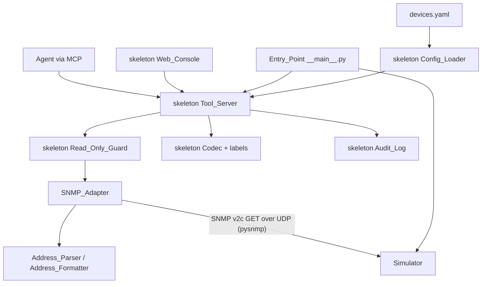
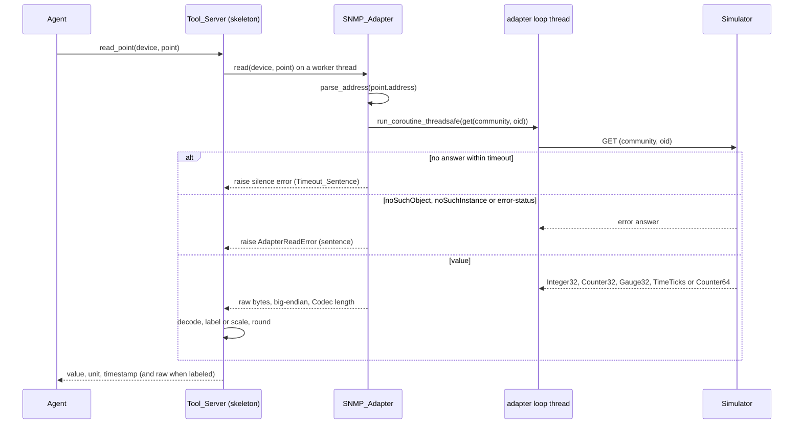

# Design Document

## Overview

The SNMP app plugs simulated network gear (a core switch, an edge router and a UPS) into the Seance skeleton. It lives in `apps/snmp/` and has the same shape as `apps/modbus/`: an address module, one adapter file, a simulator, a YAML device file and an entry point. Two small generic skeleton features (a `uint64` data type and value labels) are built first, each as its own task.

Decisions in this document:

| Question | Decision |
|---|---|
| Address format | `<community>:<oid>`, as the requirements propose. No refinement is needed. |
| Field name for the raw integer next to a label | `raw` |
| Simulator | A minimal v2c responder on an asyncio UDP socket. It does not import `pysnmp`. |
| Adapter | `pysnmp` 7.1.x, `v3arch` asyncio `get_cmd` only, on one private event loop in one background thread. |
| Skeleton changes | `DataType.UINT64` and `PointConfig.labels`, separate tasks, no mention of SNMP. |
| Console port in the Kiro entry | `8083` |

Two points in the requirements affect this design:

1. **The app ships 19 Points.** Criteria 4.3 (8 Points), 4.4 (6) and 4.5 (5) list 19 Points in total, matching Requirement 4.2, and this design uses 19 everywhere.
2. **The Simulator does not use pysnmp.** The glossary allows either approach, but Requirement 2.16 says the adapter is the only file in the repository that imports pysnmp. The Simulator is a hand-written v2c responder on an asyncio UDP socket, which satisfies 2.16 and is the main reason for choosing it.

### Research summary

- **Current pysnmp.** PyPI lists pysnmp 7.1.34 (LeXtudio fork), which requires Python 3.11.5 or newer. The docs for 7.1 show `async get_cmd(snmpEngine, authData, transportTarget, contextData, *varBinds, **options)` returning `(errorIndication, errorStatus, errorIndex, varBinds)`, with `UdpTransportTarget.create((host, port), timeout=..., retries=...)` as an awaited factory and `lookupMib` as an option. Sources: [get_cmd (v3arch)](https://docs.lextudio.com/pysnmp/v7.1/docs/hlapi/v3arch/asyncio/manager/cmdgen/getcmd), [get_cmd (v1arch)](https://docs.lextudio.com/pysnmp/v7.1/docs/hlapi/v1arch/asyncio/manager/cmdgen/getcmd).
- **Event loop binding.** An `SnmpEngine` is bound to the event loop that first issues a request through it, and a second `asyncio.run()` leaves the engine pointing at a closed loop. The documented fix is one engine, one loop. Source: [Reusing SnmpEngine across threads](https://docs.lextudio.com/pysnmp/v7.1/faq/reuse-snmpengine-across-threads). This drives the adapter design below.
- **Old API names.** Older examples use `getCmd` and `UdpTransportTarget((host, port))`. 7.x uses `get_cmd` and `await UdpTransportTarget.create(...)`. The adapter uses the 7.x names only.
- **Verification plan for unconfirmed pysnmp details.** Three details are not confirmed from the docs: the import paths of the exception-value classes (`NoSuchObject`, `NoSuchInstance`, `EndOfMibView`), the shape of `varBinds` with `lookupMib=False`, and event loop behavior on Windows. They are not checked on the local machine. The first adapter task writes three tests in `apps/snmp/tests/test_adapter.py` that run on GitHub Actions (ubuntu), and the adapter code for each detail is written only after its test result is read from that run:
  - `test_pysnmp_exception_value_imports` imports `NoSuchObject`, `NoSuchInstance` and `EndOfMibView` from the module path the adapter uses and checks that the classes exist.
  - `test_pysnmp_varbinds_shape_lookup_mib_false` sends a GET with `lookupMib=False` to the Simulator for an integer Point, a Counter64 Point and an undefined OID. It checks the tuple shape of `varBinds`, how to read the OID and the value from an entry, and that the undefined OID yields an instance of the imported `NoSuchObject`.
  - `test_pysnmp_event_loop_reuse` makes many reads through one adapter and checks that the adapter keeps one loop, one thread and one `SnmpEngine`, and that a second read after the first does not fail with a closed-loop error.

  Windows behavior (the default Proactor loop versus `SelectorEventLoop`) cannot be exercised on ubuntu. The design does not depend on it: the adapter uses one private loop on its own thread, as in the Architecture section, and the Windows loop choice is left as a documented, untested risk.
- **Content note.** Content from the pysnmp docs was rephrased for compliance with licensing restrictions.

## Architecture



Read path for one `read_point` call:



### Layering rules

- `apps/snmp/adapter.py` is the only file in the repository that imports `pysnmp` (Requirements 2.16, 11.1). `simulator.py` does not.
- `adapter.py` imports nothing from `apps/` except `apps/snmp/address.py` (Requirement 2.17).
- `apps/snmp/` imports only `seance`, `pysnmp` (adapter only) and the standard library. It imports nothing from `apps/modbus`.
- No SET PDU is built outside `simulator.py` (Requirement 2.4). The Simulator's request encoder lives in `simulator.py` so tests can send a SET to the Simulator without any other file knowing how.
- `apps/modbus/` is not changed (Requirement 11.3). Adding `UINT64` to `DataType` does not change its behavior.

### Startup sequence (Entry_Point)

1. Read `SEANCE_SNMP_HOST`, `SEANCE_SNMP_PORT`, `SEANCE_CONSOLE_HOST`, `SEANCE_CONSOLE_PORT` with defaults `127.0.0.1`, `1161`, `127.0.0.1`, `8080`. A bad port stops with one message naming the variable and the range 1 to 65535 (Requirement 7.7).
2. Start the Simulator with the Default_Seed (1). If the UDP port is busy, stop with one message naming the port and `SEANCE_SNMP_PORT` (Requirement 7.8).
3. Build `SnmpAdapter(simulator.host, simulator.port)`, check the config (`check_points`), then call the skeleton `serve`, which connects the adapter, starts the console and runs MCP on stdio.
4. All messages go to standard error (Requirement 7.9).
5. When `serve` returns, it has stopped the console and closed the adapter. The Entry_Point stops the Simulator and exits (Requirement 7.10).

## Components and Interfaces

### Skeleton change 1: `uint64` (task, generic)

Files: `skeleton/seance/points.py`, `skeleton/seance/codec.py`.

- `DataType.UINT64 = "uint64"`.
- `codec._LENGTHS[UINT64] = 8`, `_INT_FORMATS[UINT64] = ">Q"`, `_INT_RANGES[UINT64] = (0, 2**64 - 1)`.
- `config.py` needs no code change: `DataType(type_text)` accepts the new member and its error message lists `DataType` members, so `uint64` appears in it.
- `apply_scale` already handles Python integers of any size. A 64-bit counter times a positive scale keeps its sign.
- Existing skeleton property tests draw from `list(DataType)` (`test_codec_properties.py`, `test_config_properties.py`), so the round trip, wrong-length and config round trip cover `uint64` with no edit. The task adds an example test at the boundaries 0 and `2**64 - 1`, and checks that any skeleton test that hard-codes the list of data types still passes.
- The Modbus adapter would read `uint64` as four registers. No Modbus point uses it, and the Modbus app is not changed.

### Skeleton change 2: value labels (task, generic)

Files: `skeleton/seance/points.py`, `config.py`, `server.py`.

```python
@dataclass(frozen=True)
class PointConfig:
    name: str
    address: str
    data_type: DataType
    unit: str
    scale: float | None = None
    decimals: int | None = None
    labels: tuple[tuple[int, str], ...] | None = None
```

**Config.** An optional YAML map on a point:

```yaml
labels:
  1: up
  2: down
```

`_load_point` turns it into a tuple of `(int, str)` pairs in file order. `dump_config` writes it back as a map in the same order, so the config round trip (skeleton Property 1) still holds. The loader rejects, with a `ConfigError` that names the file, the device and `points[<name>].labels`:

- labels on a `bool` or `float32` point,
- a key that is not an integer (a quoted string or a boolean),
- empty or non-text label text,
- an empty map.

`load_config` keeps its standard YAML loading. PyYAML keeps the last of two equal keys in a mapping, and the loader does not detect repeated label keys.

**Server.** `_read_value` currently runs `round_value(apply_scale(decode(...)))`. It becomes:

1. `decoded = decode(point.data_type, raw)`.
2. If `point.labels` is set and `decoded` is an `int` (not `bool`) and `decoded` is a key in the labels, the result is `value = <text>` and `raw = decoded`.
3. Otherwise the existing path runs on `decoded`: scale, then round.

The lookup uses the decoded, unscaled integer (skeleton AC 1). A label point with a `scale` therefore never scales a mapped integer. An unmapped integer returns the scaled value it would return without labels.

**Result shape.** Existing results are `device`, `point`, `value`, `unit`, `timestamp`. A labeled read adds one key, `raw`:

```json
{"device": "core_switch", "point": "port3_status", "value": "down", "unit": "state", "raw": 2, "timestamp": "2025-01-01T00:00:00+00:00"}
```

`raw` appears only when a label was applied. A point without labels, and an unmapped integer on a point with labels, return the same keys as before (skeleton AC 2 and 3). The unit stays on every result. `read_points` uses the same helper, so it carries `raw` too. The Web_Console already shows `value` through `_esc`, so it shows `down` with no change. Audit recording is unchanged: `ToolServer.call` still writes one entry in its `finally` block (skeleton AC 5).

**Why `raw`.** The skeleton already uses "raw" for the unscaled, decoded form: `RawValue`, "raw bytes" from `ProtocolAdapter.read`, and "raw value (before scale)" in the Modbus simulator. `raw` names the same thing next to a label. `value` and `unit` stay in the places an agent already reads. `code` was rejected because it hides that the number is the device's own reading. `raw_value` was rejected as redundant next to `value`.

`list_points` is unchanged. It does not list labels, so an agent learns the words from a read.

### `apps/snmp/address.py`: Address_Parser and Address_Formatter

```python
OID_ARC_MAX = 4294967295

@dataclass(frozen=True)
class SnmpAddress:
    community: str
    oid: tuple[int, ...]

class AddressError(ValueError):
    """A short sentence naming the bad field and the allowed values."""

def parse_address(text: str) -> SnmpAddress: ...
def format_address(address: SnmpAddress) -> str: ...
def format_oid(oid: tuple[int, ...]) -> str: ...
```

The address is `<community>:<oid>`, for example `core_switch:1.3.6.1.2.1.2.2.1.8.3`. It is self-contained, it names the device to ask and it carries a numeric OID, so no change is needed to the form in the glossary.

Checks run left to right and the first failure is reported, so the sentence always names the leftmost problem:

1. `text.split(":")` must give exactly two parts, else `The address must have the form <community>:<oid>.` (3.4).
2. Community: non-empty, starts with a lowercase ASCII letter, then only lowercase letters, digits and underscores, else a sentence naming `community` and these characters (3.5). The leading-letter rule comes from the glossary and is stricter than 3.5; every device name already satisfies it.
3. OID: split on `.`. At least two arcs, no empty arc, every arc ASCII digits only, no leading zero except the arc `0` itself, else a sentence naming `oid` and an example such as `1.3.6.1.2.1.1.3.0` (3.6, 3.9: a name such as `sysUpTime` fails the digit check).
4. Each arc is at most 4294967295 (3.8).
5. First arc at most 2, and when the first arc is below 2, the second arc at most 39, else a sentence naming `oid` and the allowed arc values (3.7).

`format_address` returns `f"{community}:{'.'.join(map(str, oid))}"`. Parse rejects leading zeros, so every valid text is already canonical and the round trip needs no normalisation. `AddressError` has the same shape as the Modbus one but is its own class: apps do not import each other.

### `apps/snmp/simulator.py`: Simulator

**Decision: a minimal asyncio UDP v2c responder, not a pysnmp agent.**

| | pysnmp agent (`CommandResponder`) | Minimal responder |
|---|---|---|
| `pysnmp` outside the adapter | Yes. Breaks Requirement 2.16 as written. | No |
| Choose the device by community | Needs a community-to-context mapping (`CommunityData` index, `addContext`, `addVacmUser`). | One dictionary lookup |
| Record every PDU type, including a SET | Needs a hook on the dispatcher. Unrecognized requests may be dropped before the hook. | The responder sees every datagram |
| Silence for an unknown community | Library behavior and counters, hard to assert. | `return` |
| SET answers and values stay unchanged | Needs a read-only access rule. | Answer `notWritable`, never touch state |
| Event loop lifecycle | Engine plus dispatcher lifecycle, tied to a loop. | One loop, one transport, one task |
| Independent check of the adapter | The simulator and the adapter share one library, so a shared bug passes the tests. | A separate BER codec, so every adapter test is also an interoperability test |
| Cost | Little code. | About 250 lines of BER, which Property 7 tests |

The responder wins on the requirement conflict, on PDU recording and on test independence. The cost is a small, bounded BER codec. It supports only what the requirements name: SNMP v2c; PDUs GET (`A0`), GETNEXT (`A1`), SET (`A3`) and GETBULK (`A5`); response PDU `A2`; value types Integer32 (`02`), Counter32 (`41`), Gauge32 (`42`), TimeTicks (`43`), Counter64 (`46`), and the exception values noSuchObject (`80`), noSuchInstance (`81`) and endOfMibView (`82`).

```python
class PduType(StrEnum):
    GET = "GET"
    GETNEXT = "GETNEXT"
    GETBULK = "GETBULK"
    SET = "SET"

@dataclass(frozen=True)
class PduRecord:
    pdu_type: PduType
    community: str
    oids: tuple[str, ...]

class SimulatorError(RuntimeError): ...

class Simulator:
    def __init__(self, host: str, port: int, seed: int, drift: bool = True) -> None: ...
    host: str; port: int; seed: int; running: bool          # properties
    pdus_seen: tuple[PduRecord, ...]                         # snapshot
    def start(self) -> None: ...
    def stop(self) -> None: ...
    def get_value(self, device: str, name: str) -> int: ...
    def set_value(self, device: str, name: str, value: int) -> None: ...  # tests, clamps
    def drift_step(self) -> None: ...

def encode_request(pdu_type: PduType, community: str, oids: tuple[str, ...], request_id: int = 1) -> bytes: ...
def decode_response(data: bytes) -> Response: ...
```

`encode_request` and `decode_response` are the test-side half of the codec. They are in `simulator.py` so that no other file builds a SET PDU (Requirement 2.4). `drift=False` turns the periodic task off, so a test that sets a value and reads it back is not disturbed by drift. It does not change what `drift_step()` does.

**State model.** Like the Modbus `MEMORY_MAP`, one tuple of `OidEntry` is the single source of truth, and `devices.yaml` must match it (a test checks every YAML point against it):

```python
@dataclass(frozen=True)
class OidEntry:
    device: str            # also the community
    name: str
    oid: tuple[int, ...]
    snmp_type: SnmpType    # INTEGER, COUNTER32, GAUGE32, TIMETICKS, COUNTER64
    initial: int
    minimum: int
    maximum: int
    step: int              # largest drift per tick; 0 for static status values
```

| Kind | Behavior per drift tick (0.5 s) |
|---|---|
| Gauge or INTEGER with `step > 0` | `value += rng.randint(-step, step)`, clamped to `[minimum, maximum]` |
| Counter (Counter32, Counter64) | `value += rng.randint(0, step)`, then wrap with `% 2**32` or `% 2**64` |
| TimeTicks | `value += 50` (0.5 s at 100 ticks per second), wrap at `2**32` |
| Status (`step == 0`) | unchanged |

The random numbers come from one `random.Random(seed)`, drawn in map order, one per entry with `step > 0` per tick. Equal seeds therefore give equal sequences (Requirement 1.3). Status values are fixed, not drawn, so the Default_Seed always reports `core_switch` port 3 as `2` (down) and everything else healthy (1.4). The seed changes only drift. `drift_step()` takes the state lock, so tests and the drift task never interleave.

The OID map (all standard OIDs, so nothing under `1.3.6.1.4.1.99999` is needed):

| Device | Point | OID | Type | Initial | Range / step |
|---|---|---|---|---|---|
| core_switch | uptime | 1.3.6.1.2.1.1.3.0 | TimeTicks | 8640000 | wraps |
| core_switch | port1_status | 1.3.6.1.2.1.2.2.1.8.1 | INTEGER | 1 | static |
| core_switch | port2_status | 1.3.6.1.2.1.2.2.1.8.2 | INTEGER | 1 | static |
| core_switch | port3_status | 1.3.6.1.2.1.2.2.1.8.3 | INTEGER | 2 | static |
| core_switch | port4_status | 1.3.6.1.2.1.2.2.1.8.4 | INTEGER | 1 | static |
| core_switch | uplink_in_octets | 1.3.6.1.2.1.31.1.1.1.6.5 | Counter64 | 5000000000 | step 400000 |
| core_switch | uplink_out_octets | 1.3.6.1.2.1.31.1.1.1.10.5 | Counter64 | 3200000000 | step 300000 |
| core_switch | uplink_in_errors | 1.3.6.1.2.1.2.2.1.14.5 | Counter32 | 12 | step 1 |
| edge_router | uptime | 1.3.6.1.2.1.1.3.0 | TimeTicks | 4320000 | wraps |
| edge_router | cpu_load | 1.3.6.1.2.1.25.3.3.1.2.1 | INTEGER | 23 | 0..100, step 3 |
| edge_router | memory_used | 1.3.6.1.2.1.25.2.3.1.6.1 | INTEGER | 412 | 0..1024, step 8 |
| edge_router | wan_link_status | 1.3.6.1.2.1.2.2.1.8.1 | INTEGER | 1 | static |
| edge_router | wan_in_octets | 1.3.6.1.2.1.31.1.1.1.6.1 | Counter64 | 7000000000 | step 250000 |
| edge_router | wan_out_octets | 1.3.6.1.2.1.31.1.1.1.10.1 | Counter64 | 2100000000 | step 120000 |
| ups | battery_charge | 1.3.6.1.2.1.33.1.2.4.0 | INTEGER | 98 | 0..100, step 1 |
| ups | runtime_remaining | 1.3.6.1.2.1.33.1.2.3.0 | INTEGER | 42 | 0..120, step 1 |
| ups | on_battery | 1.3.6.1.2.1.33.1.4.1.0 | INTEGER | 3 | static (3 normal) |
| ups | output_load | 1.3.6.1.2.1.33.1.4.4.1.5.1 | INTEGER | 37 | 0..100, step 2 |
| ups | temperature | 1.3.6.1.2.1.33.1.2.7.0 | INTEGER | 27 | 15..45, step 1 |

`memory_used` is `hrStorageUsed`, which counts allocation units. The Simulator treats one unit as 1 MiB and the config unit is `MiB`; the YAML says so in a comment. `on_battery` is `upsOutputSource` (3 normal, 5 battery), which is how UPS-MIB reports "on battery".

**Request handling** (all on the Simulator's loop, in `datagram_received`):

1. Decode the datagram. A malformed datagram or a version other than v2c is dropped silently and not recorded.
2. Append a `PduRecord` (type, community, OIDs) under the record lock.
3. Unknown community: no response (1.8).
4. GET: for each OID, the value, or noSuchObject when the device does not define it (1.9).
5. GETNEXT: the first defined OID greater than the request OID in numeric order, or endOfMibView.
6. GETBULK: `non-repeaters` varbinds as GETNEXT, then up to `max-repetitions` rounds over the rest, capped at 20 varbinds in total so the response fits one datagram.
7. SET: a response with error-status `notWritable` (17) and error-index 1, with state untouched (1.11).
8. Send the response with `transport.sendto`.

**Event loop and lifecycle.** The same rules as the Modbus simulator:

- A Simulator runs once. `start()` creates exactly one event loop (`asyncio.new_event_loop()`) on a daemon thread, binds a UDP endpoint with `loop.create_datagram_endpoint`, and returns when the port is bound (`ready` event). A second `start()` raises `SimulatorError`, so "start again after stop" (1.15) means a new instance on the same port.
- Port 0 asks the OS for a free port and `port` returns the real one after `start()`.
- The drift runs as one asyncio task on that loop (`while True: await asyncio.sleep(0.5); drift_step()`), not as a thread. `drift=False` skips creating it.
- `stop()` cancels the drift task, closes the transport, stops the loop and joins the thread, all within a 2 second deadline (1.14). The thread closes the loop in a `finally` block. A busy port is detected by the bind itself: the UDP endpoint is created without address reuse, so a second bind to a busy port raises `OSError`, which `start()` turns into "Port N is already in use. Try another port." The Modbus simulator needs an extra probe for this on Windows; UDP here does not.
- Windows cost: each Simulator costs one loopback socket pair for the loop plus one UDP socket. The test suite uses one module-scoped Simulator (Requirement 12.4), and the lifecycle tests create a few more on purpose.
- UDP has no TIME_WAIT, so a new Simulator can bind the same port immediately after `stop()`.

### `apps/snmp/adapter.py`: SnmpAdapter

```python
class SnmpAdapter:
    def __init__(self, host: str, port: int) -> None: ...
    def connect(self) -> None: ...
    def close(self) -> None: ...
    def read(self, device: DeviceConfig, point: PointConfig) -> bytes: ...
    def health(self, device: DeviceConfig) -> HealthStatus: ...
```

**API choice.** `pysnmp.hlapi.v3arch.asyncio` with `SnmpEngine`, `CommunityData(community, mpModel=1)` (v2c), `ContextData()`, `ObjectType(ObjectIdentity(oid_text))` and `get_cmd`. Only `get_cmd` is imported from the command-generator set, so there is no import of `set_cmd`, `next_cmd` or `bulk_cmd` to find (Requirements 2.3, 2.4, 6.4). `v3arch` is chosen over `v1arch` because its engine lifecycle is the one the pysnmp FAQ documents. Pass `lookupMib=False` so the call does not load MIB files or reach out for them, and give `ObjectIdentity` the numeric OID text.

**Threading and the loop.** The skeleton calls `read` and `health` from a thread pool (up to 8 workers), each call synchronous. The adapter therefore owns exactly one event loop:

- `connect()` starts one daemon thread that creates one loop and runs it with `run_forever()`. It then runs a coroutine on that loop that creates the one `SnmpEngine`. The engine is first used on that loop, so its dispatcher binds to it, as the pysnmp FAQ requires.
- `read()` calls `asyncio.run_coroutine_threadsafe(self._get(...), loop).result(timeout=device.timeout_seconds + 1.0)`. No loop is created per read, per request or per tool call (Requirement 2.18, `tech.md`).
- `_get` awaits `get_cmd` inside `asyncio.wait_for(..., device.timeout_seconds)`. The transport target comes from `await UdpTransportTarget.create((host, port), timeout=device.timeout_seconds, retries=0)` and is cached per device name, so there is no repeated resolution and no retry beyond the one timeout (Requirements 2.12, 2.13).
- `close()` runs a coroutine that calls `engine.close_dispatcher()`, stops the loop with `call_soon_threadsafe`, joins the thread, then closes the loop. A second `close()` does nothing.
- Windows loop type (Proactor by default, or `SelectorEventLoop`) is not checked by any CI test, because Actions runs on ubuntu. The adapter creates its loop with `asyncio.new_event_loop()`. If a Windows run shows a transport problem, the fix is a change inside `adapter.py` only. `test_pysnmp_event_loop_reuse` covers the one-loop rule on ubuntu.

**What `read` returns.** `read` parses the address (a bad address is raised again as `AdapterReadError`, as a second check after startup), sends one GET, and converts the answer to the bytes the Codec expects:

| Returned SNMP type | Point `data_type` | Bytes |
|---|---|---|
| Integer32 | `int32` | `struct.pack(">i", v)` |
| Counter32, Gauge32, TimeTicks | `uint32` | `struct.pack(">I", v)` |
| Counter64 | `uint64` | `struct.pack(">Q", v)` |

Any other pairing raises `AdapterReadError`: `Point <p> is <data_type> but device <d> returned <SNMP type>. Check the data_type in the configuration.` The SNMP type name comes from the adapter's own small table (`INTEGER`, `Counter32`, `Gauge32`, `TimeTicks`, `Counter64`, `OCTET STRING`, and `an unsupported type` for the rest), not from a Python class name. A point whose `data_type` is `int16`, `uint16`, `float32` or `bool` has no SNMP type that fits and raises the same sentence at read time.

**Failures.**

| Situation | Exception | Sentence (one line) | Audit outcome |
|---|---|---|---|
| `errorIndication` (no answer, timeout) | `_DeviceSilent(AdapterReadError, TimeoutError)` | Tool_Server's Timeout_Sentence | `timeout` |
| noSuchObject, noSuchInstance, endOfMibView | `AdapterReadError` | `Device <d> has no value for point <p> at <oid>. Check the OID in the configuration.` | `adapter_error` |
| `errorStatus` not zero | `AdapterReadError` | `Device <d> refused the read of point <p> (<status word>). Try again later.` | `adapter_error` |
| Type does not fit | `AdapterReadError` | see above | `adapter_error` |

`_DeviceSilent` copies the Modbus adapter's trick: because it is also a `TimeoutError`, the skeleton's `_with_timeout` answers with its Timeout_Sentence (`... did not respond within 2s. Try again or check the device connection.`), which names the device and gives the next step (Requirements 2.9, 5.7). The error-status words come from a fixed table of the standard names (`tooBig`, `noSuchName`, `genErr`, `noAccess`, `notWritable` and so on) with `status <n>` as the fallback. No sentence contains a stack trace or a `pysnmp` module or exception class name (Requirement 2.20). The standard SNMP type names such as `Counter64` are protocol vocabulary and are allowed in the type-mismatch sentence, which Requirement 2.10 asks for.

**Health.** `health(device)` reads the device's first point through the same path. `ok` when it answers, `degraded` on any `AdapterReadError` that is not silence, `unreachable` on silence (2.11). A device with no points reports `ok` when the engine is running, else `unreachable`.

### `apps/snmp/devices.yaml`

Three devices, 19 Points in total, named after the community. Every address is `<device>:<oid>`.

| Device | Point | Type | Unit | Scale | Labels |
|---|---|---|---|---|---|
| core_switch | uptime | uint32 | s | 0.01 | none |
| core_switch | port1_status to port4_status | int32 | state | none | 1 up, 2 down, 3 testing, 4 unknown, 5 dormant, 6 notPresent, 7 lowerLayerDown |
| core_switch | uplink_in_octets, uplink_out_octets | uint64 | B | none | none |
| core_switch | uplink_in_errors | uint32 | errors | none | none |
| edge_router | uptime | uint32 | s | 0.01 | none |
| edge_router | cpu_load | int32 | percent | none | none |
| edge_router | memory_used | int32 | MiB | none | none |
| edge_router | wan_link_status | int32 | state | none | same as ports |
| edge_router | wan_in_octets, wan_out_octets | uint64 | B | none | none |
| ups | battery_charge | int32 | percent | none | none |
| ups | runtime_remaining | int32 | min | none | none |
| ups | on_battery | int32 | state | none | 1 other, 2 none, 3 normal, 4 bypass, 5 battery, 6 booster, 7 reducer |
| ups | output_load | int32 | percent | none | none |
| ups | temperature | int32 | degC | none | none |

The data types cover `uint32`, `int32` and `uint64` (Requirement 4.9). Every unit is non-empty text (4.10). Labels name more values than the Simulator reports, which satisfies 4.8. Timeouts use the skeleton default of 2 seconds.

### `apps/snmp/__main__.py`: Entry_Point

The structure of `apps/modbus/__main__.py` is reused, with these differences:

- Names: `ENV_HOST = "SEANCE_SNMP_HOST"`, `ENV_PORT = "SEANCE_SNMP_PORT"`, `DEFAULT_PORT = 1161`, `SIMULATOR_SEED = 1`.
- `check_points(config_path)` replaces `check_addresses`. It loads the config, then for each point it calls `parse_address` (a failure names device, point and reason, Requirement 4.13) and compares the community with `device.name` (a mismatch names device, point and both values, 4.14).
- `StartupError`, `read_port`, `main(env, serve_fn, simulator_factory, config_path, stderr)` keep the same signatures, so tests can inject a fake `serve` and a fake simulator factory exactly as the Modbus tests do.
- `main` returns 0 on a normal stop and 1 after printing one startup message.

The `apps/` packages do not import each other, so these helpers are copied, not shared. If they should be shared, that is a skeleton design question and is not part of this spec.

### Kiro MCP entry (Requirement 10)

The agent cannot write `.kiro/settings/mcp.json`. The MCP task prints this entry for the user to add under `mcpServers`, next to the unchanged `seance-modbus` entry:

```json
"seance-snmp": {
  "command": "uv",
  "args": ["run", "python", "-m", "apps.snmp"],
  "env": {
    "SEANCE_CONSOLE_PORT": "8083"
  },
  "disabled": false,
  "autoApprove": [
    "list_devices",
    "list_points",
    "read_point",
    "read_points",
    "device_health"
  ]
}
```

Console port 8083 differs from the default 8080, from `seance-modbus` (8081) and from the WSL Modbus entry in the user-level file (8082). The SNMP simulator port stays at its default, 1161, because no other entry uses UDP. `apps/snmp/tests/test_mcp_config.py` is written after the user adds the entry. It reads the file and checks criteria 10.3 to 10.9, and it fails with a message that names the missing entry when the user has not added it.

## Data Models

Skeleton additions: `DataType.UINT64` and `PointConfig.labels` (above). App-local types:

```python
@dataclass(frozen=True)
class SnmpAddress:       # address.py
    community: str
    oid: tuple[int, ...]

class AddressError(ValueError): ...            # address.py

class PduType(StrEnum): ...                    # simulator.py
@dataclass(frozen=True)
class PduRecord: ...                           # simulator.py
@dataclass(frozen=True)
class OidEntry: ...                            # simulator.py
class SimulatorError(RuntimeError): ...        # simulator.py

class StartupError(Exception): ...             # __main__.py
```

`PointConfig`, `DeviceConfig` and `Configuration` are otherwise used as the skeleton defines them. The `address` field stores the plain `<community>:<oid>` string.

## Correctness Properties

*A property is a characteristic or behavior that should hold true across all valid executions of a system-essentially, a formal statement about what the system should do. Properties serve as the bridge between human-readable specifications and machine-verifiable correctness guarantees.*

### Reflection on the prework

- 6.1, 6.2 and 6.3 are one claim from three sides: the PDU record of the Simulator holds only GETs, and a rejected call adds nothing. They become Property 1. 6.4 (the adapter sends no GETNEXT or GETBULK) is covered by the same record, because the property checks the set of PDU types is exactly `{GET}`.
- 2.7 and 7.12 both say the tool value equals the Simulator state after decoding and scaling. They merge into Property 2, which also covers labels through the config.
- 3.1, 3.2 and 3.3 are one round trip (Property 3). 3.4 to 3.9 are one rejection property with one defect per generated text (Property 6).
- 1.3, 1.6 and 1.7 all run `drift_step` for any seed and step count. They merge into Property 8 (determinism, bounds, counters). 1.5 is a timing example.
- The skeleton `uint64` change (Property 4) extends the existing codec properties. Because the existing generators draw from `list(DataType)`, it needs one example for the boundary values and no new generator code.
- Labels (Property 5) is tested in the skeleton with the fake adapter, because it is a skeleton feature.
- Property 7 (BER round trip) is added for the hand-written codec. A parser or encoder always gets a round trip.
- Criteria such as the file contents of `devices.yaml`, README headings, MCP config, tool parity, lifecycle timing and import scans are examples or smoke checks, not properties.

### Property 1: Only GET requests reach the Simulator

For any sequence of tool calls made through the Tool_Server against the SNMP app, including calls that carry a write tool name or a write argument set, the set of PDU types the Simulator records for that sequence is a subset of `{GET}`, and every call the guard rejects adds zero PDUs.

**Validates: Requirements 6.1, 6.2, 6.3, 6.4**

### Property 2: A read returns the Simulator state after decoding, scaling and labeling

For any Point in `devices.yaml` and any raw value inside the type's range that the Simulator holds for it, the Tool_Server result for `read_point` has `value` equal to the text mapped by the Point's labels when the raw value is labeled (with `raw` equal to the raw value), and otherwise equal to the raw value after the skeleton's scale and rounding.

**Validates: Requirements 2.6, 2.7, 5.1, 5.3, 5.4, 5.5, 7.12**

### Property 3: Address round trip

For any valid community (a lowercase letter followed by lowercase letters, digits and underscores) and any valid OID (at least two arcs, first arc 0 to 2, second arc at most 39 when the first is below 2, every arc 0 to 4294967295), formatting then parsing returns the same community and OID, and formatting the parsed result returns the original text.

**Validates: Requirements 3.1, 3.2, 3.3**

### Property 4: `uint64` decode then encode returns the original bytes

For any 8-byte sequence, decoding it as `uint64` then encoding the result returns the original bytes, and for any decoded `uint64` value and any positive scale, the scaled value has the same sign as the value.

**Validates: Requirements 4.9, 5.4** (and the acceptance of "Skeleton change 1: unsigned 64-bit data type")

### Property 5: Labels map known integers and leave unknown ones alone

For any Point with integer data type and labels, and any integer of that type, the `read_point` result has `value` equal to the mapped text and `raw` equal to the integer when the integer is a key, and otherwise has the same `value` it would have without labels, has no `raw` key, and is not an error.

**Validates: Requirements 5.1, 5.2** (and the acceptance criteria 1 to 3 of "Skeleton change 2: value labels")

### Property 6: A malformed address is rejected with a sentence naming the bad field

For any address text that is valid except for exactly one defect (a missing or extra colon part, an empty community or one with a character outside lowercase letters, digits and underscore, an OID with fewer than two arcs, an empty arc, a non-numeric arc, a leading zero, a name instead of a number, an arc above 4294967295, a first arc above 2, or a second arc above 39 under first arc 0 or 1), `parse_address` raises `AddressError`, and its message names the form, `community` or `oid` that matches the defect.

**Validates: Requirements 3.4, 3.5, 3.6, 3.7, 3.8, 3.9**

### Property 7: BER values round trip

For any integer in the range of its SNMP type, any OID the Address_Parser accepts and any octet string up to 255 bytes, encoding then decoding with the Simulator's BER codec returns the original value.

**Validates: Requirements 1.9, 1.10**

### Property 8: Drift is deterministic, bounded and monotonic

For any seed and any number of drift steps from 0 to 200, two Simulators built with the same seed have equal state, every drifting value stays between its minimum and maximum, and every counter either did not decrease or wrapped past its type maximum from within one step of that maximum.

**Validates: Requirements 1.3, 1.6, 1.7**

## Error Handling

- **Startup.** A bad `devices.yaml` field raises `ConfigError` (file, device, field). A bad address, a community that differs from the device name, a bad port variable and a busy UDP port raise `StartupError`. `main` prints one message to standard error and returns 1 before any tool is served (Requirements 4.12 to 4.14, 7.7, 7.8).
- **Read failures** raise `AdapterReadError` or `_DeviceSilent` with the sentences above. The skeleton clips them to one line and 200 characters and records one audit entry with outcome `adapter_error` or `timeout` (Requirements 2.19, 5.8, 5.9).
- **Simulator stopped.** Every read ends in `_DeviceSilent`, so the Tool_Server returns its Timeout_Sentence within the device timeout (Requirement 5.7). `health` returns `unreachable`.
- **Unmapped label.** Returns the integer with no error (Requirement 5.2).
- **Type mismatch.** A short sentence naming the point, the configured type and the SNMP type that came back (Requirement 2.10).
- **Simulator input.** A malformed datagram, an unknown community and a wrong version produce no response and no state change. A request the Simulator cannot parse never raises out of `datagram_received`.
- **No stack trace and no pysnmp exception name** reaches the agent. Sentences come from fixed templates. The raw exception text is logged to standard error only.
- **Further skeleton gaps.** If one appears while building the app, the task records it and stops for a decision (Requirement 11.5).

## Testing Strategy

PBT applies to this feature: the address parser, the BER codec, the drift rules, the codec extension and the label rule are pure logic with large input spaces, and the read path and the wire invariant hold for every point and every call sequence. PBT does not apply to the README, the MCP file, import scans, process wiring, timing or the contents of `devices.yaml`. Those use example and smoke tests.

**Property tests** use `hypothesis`, at least 100 examples each, in files named `test_*_properties.py`. Each test has a comment in the form **Feature: app-snmp, Property N: <text>**.

| Property | File |
|---|---|
| 1 | `apps/snmp/tests/test_readonly_properties.py` |
| 2 | `apps/snmp/tests/test_adapter_properties.py` |
| 3, 6 | `apps/snmp/tests/test_address_properties.py` |
| 4 | `skeleton/tests/test_codec_properties.py` (existing file; the generator already covers `uint64`) plus one added property for scale sign |
| 5 | `skeleton/tests/test_labels_properties.py` |
| 7, 8 | `apps/snmp/tests/test_simulator_properties.py` |

Rules for the SNMP property tests:

- Properties 1 and 2 share one **module-scoped Simulator** (with `drift=False` for Property 2) and one module-scoped `SnmpAdapter` and `ToolServer`. Nothing creates an event loop per example, per request or per tool call.
- Property 1 takes `len(simulator.pdus_seen)` before a sequence and checks only the slice after it, so a raw SET sent by another test does not break it.
- Property 2 calls `set_value` for the generated raw value, reads through the `ToolServer`, and compares with a reference computed from the raw value by the same skeleton helpers the other properties use.
- Properties 3 to 8 touch no socket and no event loop. Property 8 drives `drift_step()` on an unstarted Simulator or a state object, with no port.
- Hypothesis settings for properties that use sockets set `deadline=None` and use a small `max_examples` above 100 only where each example is cheap.

**Unit and example tests**, one file per source file under `apps/snmp/tests/`:

- `test_address.py`: exact error sentences for each defect and a few valid addresses.
- `test_simulator.py`: three devices by community, unknown community gets silence, noSuchObject for an undefined OID, GET, GETNEXT and GETBULK answers, a SET gets `notWritable` and changes nothing, the PDU record, the Default_Seed statuses (port 3 down), drift every second, a start then stop within 2 seconds, a new Simulator on the same port after stop, and the busy-port message.
- `test_adapter.py`: one read per SNMP type, each failure (noSuchObject, silence, type mismatch, a data type that fits no SNMP type), `health` ok, degraded and unreachable, the sentences contain no stack trace and no `pysnmp`, a socket that never answers gives silence within the timeout, many reads leave the thread count and loop count unchanged. The file also holds the three verification tests named in the research summary: `test_pysnmp_exception_value_imports`, `test_pysnmp_varbinds_shape_lookup_mib_false` and `test_pysnmp_event_loop_reuse`. They run on GitHub Actions (ubuntu), not on the local machine.
- `test_config.py`: the shipped `devices.yaml` has three devices and 19 Points, the required Points, units, scales and labels, at least one of each of `uint32`, `int32`, `uint64`, every address parses with community equal to the device name, and every Point exists in the Simulator's map with a compatible type.
- `test_server_integration.py`: `list_devices`, `list_points`, `read_point` (with a labeled value), `read_points` and `device_health` through a real `ToolServer`, a stopped Simulator gives the Timeout_Sentence, and the tool-name set equals the Modbus app's (Requirement 8).
- `test___main__.py`: environment defaults and errors, ordering, shutdown, using an injected `serve` and simulator factory.
- `test_readme.py`, `test_mcp_config.py`: headings, ASCII, the command, the four variables, the three example questions, and the JSON entry.
- `test_no_pysnmp_outside_adapter` and `test_no_set_outside_simulator`: AST scans over the repository and over `apps/snmp/` (Requirements 2.4, 2.16, 11.1).
- Skeleton tests for the two changes: `uint64` boundary example; label loader rejections (bool or float32 point, non-integer key, empty text, empty map, each naming file, device and field); a labeled read writes exactly one audit entry; an existing config without labels returns the same result shape as before; `dump_config` then `load_config` keeps labels. `skeleton/tests/test_config_properties.py` adds labels to its generator for integer types.

No test makes a network call other than UDP to the localhost Simulator. `pyproject.toml` gets `pysnmp>=7.1,<8` as a dependency and `apps/snmp/tests` in `testpaths`. The full suite is verified on GitHub Actions, and locally only ruff and one targeted pytest file run, once.

### Task order

Follows the requirements' guidance: Simulator and tests; checkpoint; `uint64`; labels; checkpoint; address parser, then adapter; checkpoint; config; entry point; checkpoint; README; print the MCP entry, then its test; final checkpoint. The first adapter task starts by writing the three pysnmp verification tests (`test_pysnmp_exception_value_imports`, `test_pysnmp_varbinds_shape_lookup_mib_false`, `test_pysnmp_event_loop_reuse`), pushing them, and reading the GitHub Actions (ubuntu) result before the rest of the adapter is written. Nothing is verified by running pysnmp locally.
