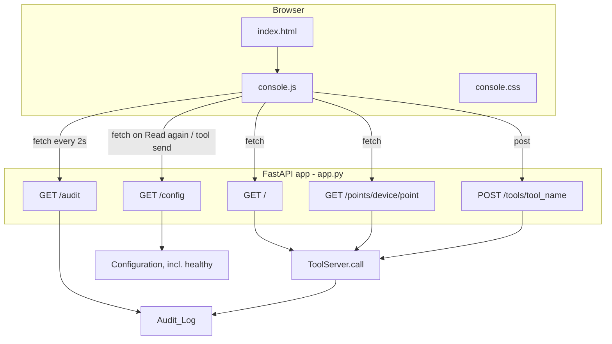

# Design Document

## Overview

This feature replaces the console's markup, stylesheet and client script, and adds one
optional field, `healthy`, to `PointConfig`. Nothing in `skeleton/seance/guard.py`,
`skeleton/seance/audit.py`, `skeleton/seance/adapter.py`, `skeleton/seance/server.py`'s
tool handlers, or any `apps/*/adapter.py` changes. The console keeps reading values
through `ToolServer.call`, so the audit format and the one-entry-per-call rule hold
unchanged.

Four decisions, asked for explicitly in the task, are settled here:

1. **Seconds formatting** is decided by unit and value only (Design Decision 1). No point name
   and no device name appears in the HTML shell, the stylesheet or the script, and a test enforces it.
2. **Formatting and markup live in browser JavaScript**, not Python helpers. Properties 1-3
   are therefore checked as example tests against rendered HTML and against the served
   `console.js` text, per Requirement 11.4, not as Hypothesis tests. Design Decision 2
   explains why, and states plainly what Hypothesis does and does not cover here.
3. **The Ledger's reason sentences** are built in the browser from the `outcome` field that
   `/audit` already returns. `AuditEntry` and the `/audit` response shape do not change.
   Design Decision 3 covers the refresh loop's anti-duplication and anti-reorder rule.
4. **The `healthy` field** is parsed, validated and round-tripped in `skeleton/seance/config.py`
   and `skeleton/seance/points.py`, exposed to the console only through the existing
   `read_point`/`read_points` results plus a `/config` endpoint that lists each point's
   `healthy` text so the browser can compare it to the returned label. Design Decision 4
   covers the new endpoint and the `Point` fields exposed.

## Architecture



`GET /` now serves only the static shell (header, empty summary strip, an empty
devices container, empty Ledger, the Tool_Panel markup). All data — device
points, labels, healthy comparison, audit rows — arrives through fetch calls that
`console.js` issues after the shell loads. This keeps `_index_html` simple (no per-device
work at all, so no device name is ever written into the shell) and keeps every dynamic value
behind `textContent`, satisfying Requirement 3.9.

Rendering the initial read synchronously in `GET /` (as today) would also satisfy the
requirements, but splitting the static shell from the data fetch means `Read again`
and the first load use the same JavaScript code path, which is simpler to test and
keeps `_index_html` free of per-point HTML string assembly.

## Components and Interfaces

### `skeleton/seance/points.py`

```python
@dataclass(frozen=True)
class PointConfig:
    name: str
    address: str
    data_type: DataType
    unit: str
    scale: float | None = None
    decimals: int | None = None
    labels: tuple[tuple[int, str], ...] | None = None
    healthy: str | None = None
```

`healthy` is the last field so every existing positional construction in tests and
adapters (`PointConfig(name, address, data_type, unit, scale)` and similar) keeps
working unchanged.

### `skeleton/seance/config.py`

`_load_point` gains one block, after `labels` is resolved:

```python
healthy: str | None = None
if "healthy" in raw and raw["healthy"] is not None:
    field = f"{prefix}.healthy"
    value = raw["healthy"]
    if not isinstance(value, str) or not value:
        raise ConfigError(file, device, field, "must be a non-empty string")
    if labels is None:
        raise ConfigError(file, device, field, "requires 'labels' to be set")
    allowed = sorted({text for _, text in labels})
    if value not in allowed:
        raise ConfigError(
            file,
            device,
            field,
            f"must be one of the configured labels: {', '.join(allowed)}",
        )
    healthy = value
```

This directly implements Requirement 1.2 through 1.6: the field is optional (1.3),
non-empty text (1.4), requires `labels` (1.5), and must be a value already present in
`labels` (1.6). It runs after labels are parsed, so `ConfigError` for a missing or
invalid `labels` is already raised by the time the `healthy` check would need it,
except for the "`labels` is required" case (1.5), which the block above raises
directly when `labels is None`.

`dump_config` adds one line per point:

```python
if point.healthy is not None:
    entry["healthy"] = point.healthy
```

placed after the `labels` line so the YAML key order in the file stays
`name, address, data_type, unit, scale, decimals, labels, healthy`, matching the
dataclass field order. This satisfies Requirement 1.7 (round trip) and 1.8 (no
behavior change for files with no `healthy` field, since the new block only runs
when the key is present).

### `apps/snmp/devices.yaml`

Six `healthy:` lines added to the five `*_status` points (`healthy: up`) and to
`on_battery` (`healthy: normal`), per Requirement 2.1-2.2. No other line in the file
changes. `apps/modbus/devices.yaml` gets no `healthy` lines; the modbus app has no points
with `labels` that name a clear single healthy value. It changes only for
Requirement 13 (the `title` and the plain descriptions).

### `skeleton/seance/console/app.py`

Route changes:

| Route | Change |
|---|---|
| `GET /` | Serves the static shell only (see Architecture). Still calls nothing that bypasses `ToolServer.call`; it calls nothing at all, since the shell carries no data. |
| `GET /config` | **New.** Returns the device/point list the browser needs to build the shell, tiles and Tool_Panel selects, including each point's `healthy` text. Read-only, does not call the adapter, does not write an `AuditEntry` (it does not call `ToolServer.call`, mirroring `list_devices`/`list_points` data that already exists in `Configuration` without a device round trip). |
| `GET /points/{device}/{point}` | Unchanged (Requirement 10.2). |
| `POST /tools/{tool_name}` | Unchanged (Requirement 10.2). |
| `GET /audit` | Unchanged (Requirement 10.2, 8.10). |

`GET /config` response shape:

```json
{
  "title": "SNMP network gear",
  "devices": [
    {
      "name": "core_switch",
      "description": "Core switch with four ports and an uplink ...",
      "points": [
        {"name": "uptime", "unit": "s", "healthy": null},
        {"name": "port1_status", "unit": "state", "healthy": "up"}
      ]
    }
  ],
  "tools": ["device_health", "list_devices", "list_points", "read_point", "read_points"]
}
```

Exposed `Point` fields: `name`, `unit`, `healthy`. `address`, `data_type`, `scale`,
`decimals` and `labels` are omitted — the console never needs the raw encoding, only
the display unit and the healthy comparison text. `data_type` is not needed because
the Formatter branches on the *value's* JSON type (`bool`, number, or a `raw`
sibling) and on `unit`, not on the Modbus/SNMP-level `data_type`. This keeps `/config`
from leaking adapter-level detail into the browser, consistent with the skeleton
boundary (`console.py` already knows nothing about `pymodbus`/`pysnmp`). The `tools`
array feeds the Tool_Panel's tool `select` directly from `READ_TOOLS`, satisfying
Requirement 9.13 without hand-duplicating the tool name list in JavaScript.

`_index_html` no longer walks the configuration. It reads the template and returns it
unchanged:

```python
def _index_html() -> str:
    return (_TEMPLATE_DIR / "index.html").read_text(encoding="utf-8")
```

The template holds one empty `<div id="devices"></div>` in the main column. `console.js`
fetches `GET /config` and creates one `<section>` per device inside it, so a device name
or a point name reaches the Page only as data, written with `textContent`. This is what
lets the name-free test (Design Decision 1) run against `GET /` for the real
`devices.yaml` of both apps and find nothing. When there are no devices, Requirement
3.7's "No devices are configured." text is written by `console.js` after it fetches
`/config` and finds an empty list. The "no devices" and "no points" messages therefore
sit next to the rest of the rendering logic.

### `skeleton/seance/console/static/console.js`

Organized as named functions with no global mutable state beyond a few `let`
bindings for in-flight-request and last-successful-rows tracking. Key functions:

- `formatSeconds(seconds)`, `formatBytes(bytes)`, `formatBoolean(value)`,
  `formatLabeled(value, raw)`, `formatUnit(unit)`, `formatTimestamp(iso)` — the
  Formatter (Requirement 6).
- `renderTile(device, point, reading, healthy)` → `HTMLElement` — builds one Tile,
  marking it as an Attention_Tile per Requirement 5.6-5.10.
- `renderDeviceSection(container, device, readings, healthyByPoint)` — creates one
  `<section>` in the devices container and fills it with its `h2` and Tile grid, or the "No points configured." text.
- `renderSummaryStrip(devices, attentionList)` — Requirement 7.
- `reasonSentence(outcome)` — Design Decision 3.
- `renderLedgerRows(entries)` — Requirement 8.
- `refreshAll()` — drives `Read again` and the initial load: fetches `/config`, then
  issues one `read_points` tool call per device (via `/tools/read_points`, so each
  still writes exactly one `AuditEntry` through `ToolServer.call`), then renders.
- `pollAudit()` — the 2-second Ledger loop (Requirement 8.7-8.11).
- Tool_Panel wiring: `fillDeviceSelect`, `fillPointSelect`, `updateSelectState`,
  `sendTool`.

### `skeleton/seance/console/static/console.css`

Rewritten against the nine Steering_Tokens and the Tokens/Type/Layout/Tiles rules in
`.kiro/steering/design.md`. Structure:

```css
:root { /* nine custom properties, exact hex values */ }
*, html body selectors for ground/panel/ink/mute/line tokens
header, .wordmark, .chip, .summary-strip, .attention-chip
main, .device-section, .tile-grid, .tile, .tile.attention
.ledger, .ledger-row, .ledger-row.attention
.tool-panel, select, button, label
@media (max-width: 390px) { /* wrap header, 2-column grid, Ledger below */ }
```

One shared rule sets Tile height (`height: 108px` on `.tile`, nothing else sets a
height on `.tile` or its children), satisfying Requirement 5.4 and the
Requirement 12.3 test.

### `skeleton/seance/console/templates/index.html`

Rewritten to the Design document's layout order: header (wordmark, app name,
`READ-ONLY, 5 TOOLS` chip, last-read time, `Read again` button), summary strip,
`<main>` with the empty `<div id="devices">` container and the Tool_Panel, then the Ledger `<aside>`.
Loads the three Google Fonts links with `display=swap`, then `console.css`, then
`console.js` at the end of `<body>`.

## Data Models

```python
# skeleton/seance/points.py
@dataclass(frozen=True)
class PointConfig:
    name: str
    address: str
    data_type: DataType
    unit: str
    scale: float | None = None
    decimals: int | None = None
    labels: tuple[tuple[int, str], ...] | None = None
    healthy: str | None = None  # new
```

`DeviceConfig` and `Configuration` are unchanged.

`GET /config` response (new, not a dataclass — built the same way `_result_body`
builds plain dicts today):

```
{devices: [{name: str, description: str, points: [{name: str, unit: str, healthy: str | None}]}],
 tools: [str, ...]}
```

`GET /audit` response: unchanged, still `{timestamp, tool, device, point, outcome,
duration_ms}` per entry (Requirement 8.10, 10.2).

`read_point`/`read_points` payloads: unchanged (`device, point, value, unit,
timestamp`, plus `raw` when the point has labels). The console's `renderTile` reads
`unit` from `/config` and `value`/`raw`/`timestamp`/`error` from these payloads; it
never needs a new field on the tool result itself.

## Header title, plain descriptions and the device header row (Requirement 13)

### The `title` config field

`Configuration` in `skeleton/seance/points.py` gains `title: str | None = None` as its
last field, so `Configuration(devices=...)` keeps working. `load_config` reads the
top-level `title` key after the `devices` checks. An absent key or a null value gives
`None`. Any other value must be non-empty text of at most 40 characters. Otherwise it
raises `ConfigError(file, "", "title", reason)`, the same shape as the existing
top-level `devices` errors, with reasons such as `must be non-empty text` and
`must be at most 40 characters`. A boolean or a number is "not text". The skeleton
treats the value as opaque text and knows no protocol word.

`dump_config` writes `title` first in the mapping, and only when it is not `None`, so
`load_config(dump_config(cfg)) == cfg` with and without a title. The Hypothesis
configuration strategy in `test_config_properties.py` draws `title` as `None` or
non-empty text of 1 to 40 characters.

### `/config` field and header fallback

`GET /config` gains a top-level `title` key next to `devices` and `tools`:
the App_Title, or `null` when none is set. The shell holds the placeholder text
`Read-only console` in the header app-name element. After `console.js` fetches
`/config`, it sets that element with `textContent` to the title when the title is
non-empty text, and leaves the placeholder otherwise. The title therefore never
enters the HTML shell on the server side, which keeps the shell name-free. Both app
files set a title: `title: "SNMP network gear"` and `title: "Modbus factory line"`.

### Plain descriptions

Every device `description` in both `devices.yaml` files loses its parenthetical part,
for example `Core switch with four ports and an uplink`. Tests and README tables that
quote the old text are updated to the new text. No Modbus file other than
`apps/modbus/devices.yaml` and a test or README that quotes a description changes.

### Device header row layout

Each device section starts with one `div.device-head` row, a flex container with
`flex-wrap: wrap`, `align-items: baseline` and a gap. The row holds, in order, the
`h2` with the device name, a `p` with the description, and a `p` with the health text.
The name and description take the left side. The health text has `margin-left: auto`
so it sits at the right end of the row. The section rule (a 1px `--ink` bottom border)
sits on the row's bottom edge, so the row is above the rule. At 390px the items wrap
onto further lines and the health text goes to the start of its own line when it does
not fit, with `min-width: 0` and `overflow-wrap: anywhere` so no text is clipped and
the page does not scroll sideways. `console.js` only creates the three elements with
`textContent` and adds the class names. Neither file holds a device or point name.

## Design Decision 1: Seconds formatting by unit only, and a console with no names

**Rule:** the Formatter picks a format from the point's `unit` and the type of the value.
It never reads a point name, a device name or a description. Seconds follow the same
pattern as bytes: the unit `s` selects the rule, the way the unit `B` selects the byte
rule.

| Unit | Value | Shown | Detail line |
|---|---|---|---|
| `s` | 86427.5 | `1d 0h 0m` | `86,427.5 s` |
| `s` | 5400 | `1h 30m` | `5,400 s` |
| `s` | 270 | `4m 30s` | `270 s` |
| `s` | 60 | `1m 0s` | `60 s` |
| `s` | 59.9 | `59.9 s` | time of read |
| `s` | 0 | `0 s` | time of read |

```js
function formatSeconds(seconds) {
  if (seconds < 60) {
    return { text: String(seconds) + " s", detail: null };   // detail = time of read
  }
  const whole = Math.floor(seconds);
  const d = Math.floor(whole / 86400);
  const h = Math.floor((whole % 86400) / 3600);
  const m = Math.floor((whole % 3600) / 60);
  const s = whole % 60;
  const text = d > 0 ? d + "d " + h + "h " + m + "m"
             : h > 0 ? h + "h " + m + "m"
             : m + "m " + s + "s";
  return { text: text, detail: formatGrouped(seconds) + " s" };
}
```

Notes on the rule:

- The test is `value >= 60`, so a value below 60 (including 0 and negative values) is
  shown as plain seconds, and the sign is never changed (Requirement 6.10).
- Each duration part is rounded down. `86427.5` has 86427 whole seconds, which is
  1 day, 0 hours, 0 minutes and 27 seconds, so it shows `1d 0h 0m`. The 27 seconds are
  dropped from the main text and kept in the raw value on the detail line.
- The steering table only fixes the day form. The hour form `<h>h <m>m` and the
  minute form `<m>m <s>s` are this design's choice. The minute form comes from the
  request (`4m 30s` under one hour). The hour form is the missing middle step.
- The old two-part rule (unit `s` and a name containing `uptime`) is removed. A point
  with unit `s` is now formatted the same way whatever it is called, so a future
  `elapsed` point in seconds gets a duration with no code change.
- `isUptimePoint` is removed. `renderTile` receives only the unit and the value.

**No names in the console.** `console.js`, `console.css` and the HTML shell contain no
point name and no device name. The shell no longer carries `data-device` attributes
(see `_index_html` above). Names arrive from `GET /config` and from tool results and
are written with `textContent`. Source comments and string literals in `console.js`
must also avoid those names, because the test reads the whole file.

**The test** (`skeleton/tests/test_console_design.py`):

1. Load `apps/modbus/devices.yaml` and `apps/snmp/devices.yaml` with `load_config`.
2. Collect every device name and every point name from both files into a set, with the
   file each came from.
3. Build one `ToolServer` per file with the Fake_Adapter, on the shared session event
   loop, so each served `GET /` is built over a real configuration. Read
   `GET /static/console.js` once.
4. For each name, search the HTML of both pages and the `console.js` text with the
   pattern `(?<![A-Za-z0-9_])<escaped name>(?![A-Za-z0-9_])`, ignoring case. A name
   matches only as a whole identifier, so `ups` does not match inside `groups`.
5. Fail with a message naming the file, the name and where it was found (`GET /` for
   which config, or `console.js`).

Short common names (`level`, `fault`, `temperature`, `setpoint`, `uptime`, `ups`) are
the likely false positives, since an ordinary English word in a comment would trip
them. The remedy is to reword the comment in `console.js`, not to loosen the test.
`console.css` is not part of the test, as requested, but it follows the same rule and
needs no names.
## Design Decision 2: Formatting and markup in JavaScript; properties as HTML/JS-text example tests

All Tile markup, chip markup, Ledger row markup and the Formatter functions
(Requirement 6, 7, 8 rendering) live in `console.js`. None of it is duplicated as a
pure Python helper in `skeleton/seance/console/`. Reasons:

- Requirement 3.9 already requires the dynamic text to be written with
  `textContent` from JavaScript, not assembled as an HTML string anywhere (Python
  included) — the project moved away from the old Python f-string-built `<tr>` rows
  in `app.py` specifically to satisfy the escaping and `textContent` rules more
  simply by building `Element` nodes.
- Requirement 6.9 requires tool results and `/audit`/`/points` responses to carry
  raw values unchanged; keeping formatting entirely client-side makes that
  guarantee structural rather than a thing to double check in two places.
- A Python mirror of the Formatter would be a second implementation of the same
  rules that could drift from the JavaScript one; Requirement 11.4 anticipates
  exactly this shape of feature and says to fall back to example tests on rendered
  HTML and on the served `console.js` source when the logic lives in the browser.

Consequently Properties 1-3 (Requirement 11.1-11.3) are implemented as the kind of
test Requirement 11.4 names, not as Hypothesis property tests:

- **Property 1** (one Tile per configured point): a Playwright-free example test
  loads `GET /` and `GET /config` through `TestClient` for a handful of hand-built
  `Configuration` values (zero devices, a device with zero points, a device with
  many points, point names containing `&`/`<`), then runs `console.js`'s rendering
  functions against that fixture data inside a small Node-free check: because no
  real DOM/browser is available in the Python test process, the test instead parses
  `console.js` as JavaScript is not an option in a Python-only toolchain, so this
  property is checked at the level the requirement allows: an **example test over
  several representative configurations**, not over 100 Hypothesis-generated ones.
  Honestly stated coverage gap: the universal "for all configurations" claim in
  Requirement 11.1 is covered only by the representative examples chosen by the
  test author, not by generated inputs, because `console.js` runs in a browser
  DOM that the Python test process does not have. The test suite compensates by
  choosing examples deliberately: 0 points, 1 point, many points, and the
  configuration-ordering case (points out of alphabetical order) to pin down
  "in configuration order."
- **Property 2** (Attention_Chip count equals Attention_Tile count): same
  constraint and same compensating choice of examples — a config with no attention
  tiles, one with every point in attention, one with a mix, one where a device's
  every point fails.
- **Property 3** (Ledger never exceeds `AUDIT_LIMIT`, newest-first order preserved):
  this one *can* be a Hypothesis test, because the ordering and capping logic the
  requirement is about already exists on the Python side, in `Audit_Log.recent` and
  `AUDIT_LIMIT`/`GET /audit` — `test_audit_view_is_capped_at_50_newest_first` in
  `skeleton/tests/test_console.py` already exercises this at the HTTP layer. The
  console-side half of Property 3 (that `console.js`'s `renderLedgerRows` does not
  reorder or duplicate what `/audit` returns) is checked as an example test that
  feeds `renderLedgerRows` an already-fixed, newest-first array (what `/audit`
  guarantees) and asserts the rendered row order matches array order exactly —
  this is a pure function of its argument, so a handful of examples (empty array,
  one entry, duplicate-looking entries with different timestamps) fully pin down the
  behavior; a Hypothesis test over generated arrays would exercise the same single
  code path (a `for` loop with no branching on content) and would not catch more
  than the chosen examples.

To run any of `console.js`'s functions outside a browser, the test suite loads the
module into a minimal, dependency-free JS execution context from Python. Since the
tech stack has no JS test runner and no Node dependency, and the project has no
headless-browser dependency, the practical choice consistent with "no browser" and
"no event loop per example" is:

- `console.js` is written so that its pure functions (`formatSeconds`,
  `formatBytes`, `formatBoolean`, `formatLabeled`, `formatUnit`, `formatTimestamp`,
  `reasonSentence`) take plain values and return plain strings —
  no DOM access. These are the functions Requirement 6, 7.4 and 8.5 actually
  specify as testable text content.
- The Python test suite checks these functions through **example tests on the
  served `console.js` source text**, per Requirement 11.4's explicit fallback:
  it reads the deployed `console.js`, extracts and asserts on the literal strings
  and thresholds the Formatter must produce (for example, asserting the source
  contains the exact boundary arithmetic for the kB/MB/GB/TB cutoffs, and a
  table-driven text search confirming each named outcome in Requirement 8.5 maps to
  a distinct, non-empty sentence), and separately exercises markup-producing
  functions (`renderTile`, `renderSummaryStrip`, `renderLedgerRows`) through
  `TestClient` HTML assertions on `GET /` after the JSON endpoints are seeded with
  fixture `/config` and `/audit` data, matching the pattern already used by
  `test_console.py`'s `html.unescape` assertions.
- What this does **not** cover: logic bugs in `console.js` that only manifest under
  real browser execution (actual DOM mutation order, real `Intl`/`Date` locale
  behavior for `formatTimestamp`, real `fetch` timing for the 2-second poll loop).
  These are explicitly out of scope for the Python test suite and are not claimed
  to be covered. `skeleton/tests/test_console.py`'s existing `TestClient`-based
  tests remain the source of truth for anything server-rendered.

This satisfies Requirement 11.4 directly: "WHERE the Formatter, the chip count or
the Ledger ordering is implemented in JavaScript, THE Test_Suite SHALL check
Properties 1 to 3 as example tests on the rendered HTML and on the served
`console.js` source instead of Hypothesis tests." Requirement 11.5 (Hypothesis tests
for pure Python helpers) does not apply, because no such helpers exist in this
design — by choice, to keep formatting in exactly one place.

## Design Decision 3: Ledger reason sentences and the 2-second refresh

**Endpoint:** the Ledger is fed exclusively by `GET /audit`, unchanged in shape
(Requirement 8.10). No new field is added to `AuditEntry` or to the `/audit`
response. The six named sentences plus the generic fallback (Requirement 8.5) are a
lookup table in `console.js`, keyed by the existing `outcome` string:

```js
const REASON_SENTENCES = {
  rejected: "This call was not allowed because the console only reads values. Use a read tool instead.",
  unknown_tool: "This tool name is not one of the five read tools. Check the spelling and try again.",
  unknown_target: "The named device or point was not found. Check the name and try again.",
  invalid_argument: "An argument was missing or the wrong type. Check the arguments and try again.",
  timeout: "The device did not answer in time. Try again or check the device connection.",
  adapter_error: "The adapter reported an error. Try again, or check the device connection and the server log.",
};
function reasonSentence(outcome) {
  return REASON_SENTENCES[outcome]
    ?? "The call did not succeed. Check the device and arguments and try again.";
}
```

These sentences describe the *outcome category*, not the specific message text that
`ToolResult.payload` carries for that call (which the Ledger does not fetch — the
Ledger only ever sees `/audit` rows, never `/tools` payloads from other sessions'
calls). This matches Requirement 8.5's wording ("derive the reason sentence from the
outcome value") exactly, and keeps the audit format frozen.

**Anti-duplication / anti-reorder rule for the 2-second loop:**

- `pollAudit()` runs on a `setInterval(..., 2000)` started once, after the shared
  `session`-style module load (not per Tile, not per request).
- Before issuing a fetch, it checks an in-flight flag; if a previous `/audit`
  request has not resolved yet, the tick is skipped entirely (Requirement 8.11: "The
  Ledger SHALL not start a new request while the previous `/audit` request is still
  pending").
- On success, `renderLedgerRows(entries)` **replaces** the Ledger's row container
  wholesale (`replaceChildren`) with one row per array entry, in the array's order.
  Because `/audit` always returns the full newest-first window (up to
  `AUDIT_LIMIT`) rather than a delta, there is no merge step and therefore no place
  for a duplicate or a reorder to be introduced by the client: the rendered list is
  a pure, order-preserving map over whatever `/audit` returned for that tick. This
  is what makes Requirement 8.8 ("new entry at the top within 2 seconds plus request
  time") and Requirement 8.1 ("in the order that the endpoint returns them") hold
  simultaneously — the client never reorders, and the server already returns
  newest-first.
- On failure, the previous successful render is left on screen untouched (no
  `replaceChildren` call), and one line with the exact sentence `"The ledger could
  not be loaded. It will try again in 2 seconds."` is shown in addition to — not
  instead of — the kept rows (Requirement 8.9). The in-flight flag is cleared in a
  `finally` so the next tick is not permanently skipped after a failure.
- `Read again` and a Tool_Panel `Send` both call `pollAudit()`'s underlying fetch
  function directly, once, outside the interval, to satisfy "refresh the Ledger at
  once" (Requirement 9.12) without waiting for the next tick; this reuses the same
  in-flight guard so a manual refresh and a timer tick never race into two
  overlapping requests.

## Design Decision 4: the `healthy` field — parsing, errors, round trip, exposed fields

Covered in detail in Components and Interfaces above. Summary of the four sub-points
asked for:

- **Parsing:** `_load_point` in `config.py` reads `raw["healthy"]` only when the key
  is present and not `None`, mirroring how `scale` and `decimals` are already
  optional.
- **Validation errors naming file, device, field:** every new `ConfigError` call
  passes `file` (the path already in scope), `device` (the device name already in
  scope within `_load_point`), and a field path of the form `points[<name>].healthy`
  (or `points[<index>].healthy` before a name is known, consistent with how
  `labels` and `decimals` errors are already named) — satisfying Requirement
  1.4-1.6 verbatim.
- **`dump_config` round trip:** the `healthy` key is emitted only when
  `point.healthy is not None`, after `labels`, so `load_config(dump_config(cfg))
  == cfg` for configurations that do and do not use the field (Requirement 1.7,
  extending the existing `test_config_round_trip` Hypothesis strategy in
  `skeleton/tests/test_config_properties.py` with a `healthy` branch tied to the
  chosen `labels`).
- **`PointConfig` change:** one new field, `healthy: str | None = None`, appended
  last so positional construction elsewhere (tests, `apps/*/adapter.py` if any
  builds `PointConfig` positionally) is unaffected.
- **Console-exposed `Point` fields:** `name`, `unit`, `healthy` only, via the new
  `GET /config` endpoint (not `address`, `data_type`, `scale`, `decimals` or
  `labels` — the console never needs the wire encoding, and `labels` text is already
  implicitly available through each reading's `value` field when a label applies).

## Correctness Properties

*A property is a characteristic or behavior that should hold true across all valid
executions of a system — essentially, a formal statement about what the system
should do. Properties serve as the bridge between human-readable specifications and
machine-verifiable correctness guarantees.*

Per Design Decision 2 and Requirement 11.4, Properties 1-3 are checked as example
tests on rendered HTML and on the served `console.js` source, not as Hypothesis
tests, because their logic lives in browser JavaScript with no DOM available to the
Python test process. Property 4 (the `healthy` round trip) lives entirely in
`config.py`/`points.py`, is a pure Python transformation, and is checked with
Hypothesis.

### Property 1: One Tile per configured point

*For any* Configuration, the rendered device sections contain exactly one Tile for
each point in the Configuration, in configuration order within each device section.

**Validates: Requirements 5.1, 11.1**

**Test type:** example tests over representative configurations (zero devices, a
pointless device, a many-point device, out-of-alphabetical-order point names),
asserting against `GET /` plus fixture `/config` and read data, per Requirement
11.4.

### Property 2: Attention chip count equals attention tile count

*For any* Configuration and any set of read outcomes, the number of
Attention_Chips in the Summary_Strip equals the number of Attention_Tiles in the
device sections.

**Validates: Requirements 7.3, 11.2**

**Test type:** example tests over representative outcome sets (no failures, all
failures, a point with a Healthy_Label mismatch, a device whose every point fails),
per Requirement 11.4.

### Property 3: Ledger never exceeds the audit log and preserves order

*For any* sequence of Audit_Entries that `GET /audit` returns, the Ledger renders no
more Ledger_Rows than entries received, and the Ledger_Rows appear in the same order
as the entries in the response.

**Validates: Requirements 8.1, 8.2, 11.3**

**Test type:** split in two, per Requirement 11.4 and Design Decision 2 — the
capping and ordering guarantee at the HTTP layer is already a Hypothesis-amenable,
pure-Python property (`Audit_Log.recent`); the console-side guarantee (`console.js`
renders in the order received, with no merge step) is an example test, because
`renderLedgerRows` is a single order-preserving loop with no branching on entry
content.

```python
# skeleton/tests/test_audit_properties.py (existing file; extended if not already covering this)
# Feature: console-redesign, Property 3: For any sequence of recorded entries and any
# n, Audit_Log.recent(n) returns at most n entries, newest first, and never more
# entries than have been recorded.
# **Validates: Requirements 8.1, 8.2, 11.3**
@settings(max_examples=100)
@given(entries=st.lists(audit_entries(), max_size=200), n=st.integers(min_value=0, max_value=100))
def test_recent_never_exceeds_n_or_total_and_is_newest_first(entries, n) -> None:
    log = Audit_Log()
    for e in entries:
        log.record(e)
    result = log.recent(n)
    assert len(result) <= n
    assert len(result) <= len(entries)
    assert result == list(reversed(entries))[: len(result)]
```

### Property 4: Healthy-field round trip

*For any* Configuration whose points carry a mix of `labels` and `healthy` values
consistent with the validation rule (a point's `healthy`, when present, is one of
its own `labels` values), dumping the Configuration to YAML and loading it back
produces an equal Configuration.

**Validates: Requirements 1.7, 1.8**

**Test type:** Hypothesis, extending `_points()` in
`skeleton/tests/test_config_properties.py` so that whenever a point's strategy draws
`labels`, it also draws `healthy` as either `None` or one of the drawn labels'
texts; whenever `labels` is `None`, `healthy` is always drawn as `None` (matching
the validation rule, so the generator never produces a `Configuration` that
`dump_config`/`load_config` would themselves consider invalid — the round trip
property is about faithful serialization, not about validation, which is covered
separately by the example tests in Requirement 1.9).

```python
# skeleton/tests/test_config_properties.py
# Feature: console-redesign, Property 4: For any valid Configuration whose points may
# carry a healthy label consistent with their own labels mapping, loading, dumping and
# loading again produces a Configuration equal to the first.
# **Validates: Requirements 1.7, 1.8**
@settings(max_examples=100)
@given(config=_configurations)
def test_config_round_trip_with_healthy(
    config: Configuration, tmp_path_factory
) -> None: ...  # same structure as test_config_round_trip, over the extended strategy
```

## Error Handling

| Failure | Where | Behavior |
|---|---|---|
| `healthy` not non-empty text | `config.py` `_load_point` | `ConfigError(file, device, "points[<name>].healthy", "must be a non-empty string")` |
| `healthy` present, `labels` absent | `config.py` `_load_point` | `ConfigError(file, device, "points[<name>].healthy", "requires 'labels' to be set")` |
| `healthy` not among `labels` values | `config.py` `_load_point` | `ConfigError(file, device, "points[<name>].healthy", "must be one of the configured labels: ...")` naming every allowed value |
| `GET /config` called before any config loaded | n/a — config is loaded at startup; this route only serves the already-validated `server.config` | not reachable; no new failure mode |
| `/audit` fetch fails (network, 5xx) in the 2-second loop | `console.js` `pollAudit` | kept rows stay on screen; one additional line, exact text `"The ledger could not be loaded. It will try again in 2 seconds."` (Requirement 8.9); in-flight flag cleared so the next tick still fires |
| `/tools/<tool>` fetch fails from the Tool_Panel | `console.js` `sendTool` | raw-reply area shows a sentence saying the console server did not answer and to try again (Requirement 9.11), reusing the existing wording style already in `console.js` |
| A point read fails (`read_points` partial failure) | `console.js` `renderTile` | Tile renders as an Attention_Tile; detail line shows the short sentence (first line of the error text, matching the existing `test_index_shows_adapter_error_sentence_unchanged` convention), full sentence in `title` |
| Unknown device/point in a direct `/points/{device}/{point}` call | `app.py` | unchanged: same status codes and bodies as today (Requirement 10.2) |
| Config file has a `healthy` field but was written before this feature shipped and is otherwise malformed in an unrelated way | `config.py` | existing, unrelated `ConfigError` fires first, same as any other field-ordering-independent validation; `_load_point` validates in the fixed order name → address → data_type → unit → scale → decimals → labels → healthy, so errors are always reported for the first bad field in that order, consistent with existing behavior |

All error sentences returned to a human through the console UI follow the existing
project rule: short sentences naming what failed and what to try next, never a stack
trace (steering `tech.md`). `ConfigError` messages are developer/operator-facing (a
bad YAML file caught at startup), not agent-facing, and already follow this rule
throughout `config.py`.

## Testing Strategy

**Unit and example tests** (`skeleton/tests/test_config.py`,
`skeleton/tests/test_console.py`, new `skeleton/tests/test_console_design.py`):

- One example test per `healthy` `ConfigError` case (not non-empty text, missing
  `labels`, value not in `labels`), per Requirement 1.9.
- A direct round-trip example test for `dump_config`/`load_config` with a `healthy`
  field present, independent of the Hypothesis version, as a readable regression
  pin.
- `apps/snmp` config loads without error after the six `healthy:` lines are added
  (Requirement 2.3) — extends the existing "real devices.yaml loads" test if one
  exists, or adds one in `apps/snmp/tests/`.
- `GET /config` returns the expected shape, including `healthy: null` for points
  with no Healthy_Label and the configured text otherwise.
- Page-structure tests (Requirement 12.1): header, Summary_Strip, the devices container,
  Ledger and Tool_Panel are present in the static shell's HTML. The one section per
  device is created by `console.js` from `GET /config`, so the test checks the served
  `console.js` for that code path and checks `GET /config` for one entry per device.
- Name-free test (Requirement 12.11): described in Design Decision 1. It reads both apps'
  `devices.yaml` and fails if any device or point name appears in the served HTML or in
  `console.js`.
- Seconds formatting (Requirement 6.1, 6.12, 6.13): source text assertions that
  `formatSeconds` branches on the value being under 60, that the day, hour and minute
  forms exist, and that no function in `console.js` takes a point name as an argument
  to choose a format.
- CSS rule tests (Requirement 12.2, 12.5, 12.6): parse `console.css` with a small
  regex/tokenizer check (no CSS-parser dependency needed — the rules are structural:
  exactly nine custom properties in `:root` with the steering hex values; no color
  literal outside `:root`; no `box-shadow`/`text-shadow`/gradient function; every
  `border-radius` is `3px`; every `font-family` list ends in a generic family).
- Tile-height test (Requirement 12.3): exactly one rule block targeting `.tile`
  (or an equivalent single selector) sets `height`; no other selector that matches
  a Tile or its children sets `height`/`min-height`/`max-height`.
- Heading/button parenthesis test (Requirement 12.4): scan the static shell HTML
  plus any text constants in `console.js` used for headings/buttons for `(` or `)`.
- Google Fonts `display=swap` test (Requirement 12.7): the three `<link>` tags are
  present in `index.html` with `display=swap` in the `href`.
- Existing `skeleton/tests/test_console.py` tests: each one that currently asserts
  on the old server-rendered table markup (`test_index_lists_devices_and_points_with_live_values`,
  `test_index_keeps_device_names_readable_after_escaping`,
  `test_index_shows_adapter_error_sentence_unchanged`,
  `test_index_writes_one_audit_entry_per_device_with_points`) is updated to assert
  against the new data source instead (`GET /config` plus `GET /tools/read_points`
  or the fixture equivalent), since `GET /` itself no longer embeds point values.
  Tests that assert on routes, status codes and audit-entry counts
  (`test_point_route_*`, `test_tool_invocation_*`, `test_audit_*`,
  `test_console_does_not_forward_write_requests_to_the_adapter`) are expected to
  keep passing unchanged, because those routes and behaviors are untouched. The
  task that updates these tests must list, in its completion note, exactly which
  tests changed and why (Requirement 12.8).
- All console tests continue to use `Fake_Adapter` and the shared `session_portal`
  fixture (Requirement 12.9, 10.7) — no new fixture creates a per-test event loop.

**Property tests** (Hypothesis, minimum 100 examples each, tagged with the feature
name and property number):

- Property 4 (`healthy` round trip) in `skeleton/tests/test_config_properties.py`,
  extending the existing `_points()` strategy.
- Property 3's Python half, extending `skeleton/tests/test_audit_properties.py` if
  the capping/ordering property is not already present there verbatim (the existing
  `test_audit_view_is_capped_at_50_newest_first` in `test_console.py` covers the
  HTTP-layer behavior with one example; the Hypothesis version generalizes it).

**Example tests standing in for Properties 1 and 2** (per Requirement 11.4), in a
new `skeleton/tests/test_console_design.py`:

- Representative-configuration table for Property 1 (tile count and order).
- Representative-outcome table for Property 2 (chip count equals tile count).
- `console.js` source text assertions for the Formatter table in Requirement 6 and
  the reason-sentence table in Requirement 8.5 (each named outcome maps to a
  distinct, present, non-empty string in the source).

**What is not covered**, stated plainly per Design Decision 2: real-browser DOM
behavior, `Intl`/`Date` locale formatting, and real `fetch` timing for the
2-second poll are not exercised by the Python test suite. Manual verification in a
real browser (per the task list's checkpoints) is the only check for those.

**Local verification discipline** (steering `tech.md`): run `ruff check .` and
`ruff format --check .`, then at most one targeted `pytest` file once per
checkpoint (for example `uv run pytest skeleton/tests/test_config.py` after the
`healthy` field lands, then `uv run pytest skeleton/tests/test_console.py` after the
console rewrite). The full suite is verified on GitHub Actions.

## Refinements: Ledger, tiles, call source and one SNMP point name (Requirement 14)

This section supersedes the earlier statements in this document that `audit.py`, `server.py` and the `/audit` shape do not change. The only exception is the additive `source` field described below.

1. **Ledger target (14.1, 14.2).** `renderLedgerRows` in `console.js` builds the target from the entry. An entry that names more than three points shows `<device>, <n> points` and carries the full comma-separated list in the row `title`. Otherwise the device and each point name go in their own `span` with `white-space: nowrap`, joined with `, `, so lines break only at the commas. The `/audit` entry carries the point names it already records.
2. **Tile units (14.3).** `renderTile` writes the unit into a separate `span.unit`. `console.css` sets it smaller than the value and in `var(--mute)`. The 108px height stays in the single shared `.tile` rule.
3. **Detail line (14.4).** The Formatter joins detail parts with `", "`, for example `raw 1, 21:56:19`.
4. **Call source (14.5 to 14.8).** `AuditEntry` gains `source: str = "agent"` as its last field, so existing construction keeps working. `ToolServer.call` gains a keyword argument `source: str = "agent"` and passes it to the audit log, so the MCP tool handlers need no change and record `agent`. The console routes (`POST /tools/{tool_name}`, `GET /points/{device}/{point}` and the `read_points` refresh calls) pass `source="console"`. `GET /audit` adds `source` to each entry. The call count is unchanged: one entry per call.
5. **Source display (14.9).** Each Ledger_Row shows the source word in a `span`, with a class for `agent` (`var(--ink)`) and one for `console` (`var(--mute)`). The word is the text, so state is not shown by color alone. The alert colors are never used for source.
6. **Sticky Ledger (14.10, 14.11).** In the media query where the Ledger sits beside the devices, `console.css` sets `position: sticky`, a top offset, `overflow-y: auto` and `max-height: calc(100vh - <top offset>)`. Below that breakpoint the Ledger stays in normal flow.
7. **SNMP point name (14.12).** The point `on_battery` becomes `power_source` in `apps/snmp/devices.yaml`, the README tables and every test that names it. Labels and `healthy: normal` stay. `apps/snmp/adapter.py` and the Modbus files stay as they are.

**Testing.** Source and CSS checks for items 1, 2, 3, 5 and 6 go in `skeleton/tests/test_console_design.py`. The CSS rule tests extend where they would reject the new rules legitimately, for example a `max-height` on the Ledger is not a tile rule. Item 4 gets audit tests, an extended one-entry-per-call property, MCP-path tests that record `agent` and console route tests that record `console`.
