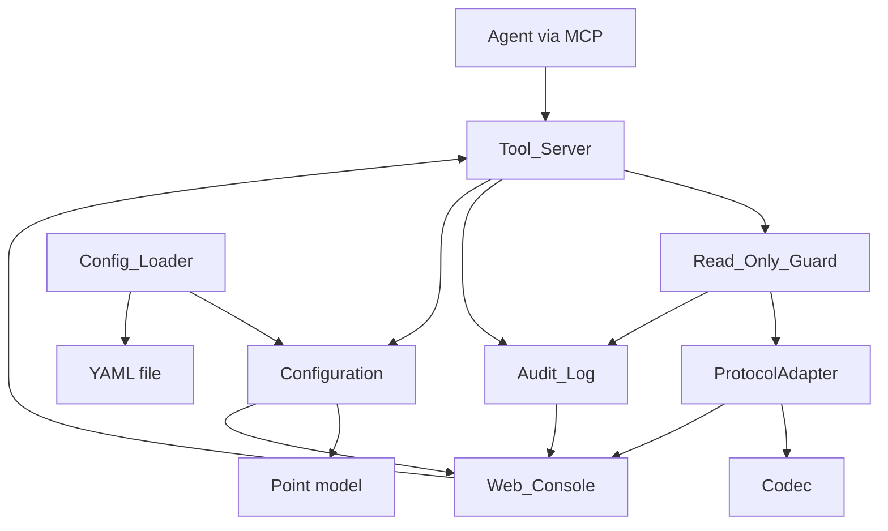
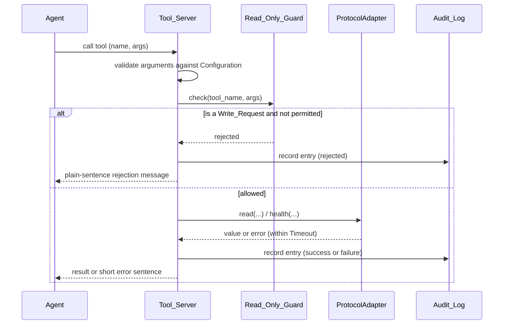

# Design Document

## Overview

The skeleton is a Python package, `skeleton/seance/`, that turns a protocol adapter plus a YAML configuration file into a running MCP server with a read-only guard, an audit log and a web console. It contains no protocol-specific code. Everything in this document concerns `skeleton/seance/` only; the Modbus and SNMP adapters that plug into it are covered by their own specs.

The skeleton's job is narrow on purpose: give an adapter author one interface to implement (`ProtocolAdapter`), and give an operator one YAML file to describe their devices. Everything else — tool exposure, timeouts, the read-only guard, auditing, the console — is handled once, in the skeleton, so it is correct for every protocol that plugs into it.

All tests in this spec use a `Fake_Adapter`, an in-memory implementation of `ProtocolAdapter` that performs no network calls and lets tests control latency, errors and returned values deterministically.

## Architecture



Request flow for a tool call:



### Layering rules

- The skeleton imports nothing from `apps/`.
- The skeleton imports no protocol library (`pymodbus`, `pysnmp`).
- `ProtocolAdapter` method signatures use only skeleton types and the Python standard library.
- `skeleton/seance/console/` depends on `Config`, `Audit_Log` and the `Tool_Server`, but nothing depends on `console/`.

### Startup sequence

1. `Config_Loader` loads and validates the YAML file into a `Configuration`. Any invalid field stops startup with a message naming the file, the device and the field.
2. The adapter author's `ProtocolAdapter` implementation is checked for the four required methods (`connect`, `close`, `read`, `health`). A missing method stops startup and names the method and the adapter class.
3. `server.py` wires the `Configuration`, the `ProtocolAdapter` instance, the `Read_Only_Guard`, the `Audit_Log` and the `Codec` into an MCP `Tool_Server`, and mounts the `Web_Console`.
4. The adapter's `connect` is called once before the server starts accepting tool calls.

## Components and Interfaces

### `adapter.py` — `ProtocolAdapter`

```python
class ProtocolAdapter(Protocol):
    def connect(self) -> None: ...
    def close(self) -> None: ...
    def read(self, device: DeviceConfig, point: PointConfig) -> bytes: ...
    def health(self, device: DeviceConfig) -> HealthStatus: ...
```

- `read` returns raw bytes for one point; the `Codec` decodes and scales them. This keeps every adapter's job identical: fetch bytes, let the skeleton interpret them.
- `health` returns a `HealthStatus` (an enum: `ok`, `degraded`, `unreachable`) plus an optional short detail string.
- There is no write method on this interface at all (Requirement 4.4). An adapter that wants to opt into writes exposes its own extra method outside `ProtocolAdapter` and registers it explicitly with the `Read_Only_Guard` allowlist (see `guard.py` below); the skeleton never calls an undeclared write path implicitly.
- At registration time, the skeleton inspects the adapter instance with `inspect.signature` / `hasattr` checks against the four required methods and raises `AdapterRegistrationError(adapter_class_name, missing_method)` if any are missing.

### `points.py` — Point model

```python
@dataclass(frozen=True)
class PointConfig:
    name: str
    address: str
    data_type: DataType  # enum: INT16, UINT16, INT32, UINT32, FLOAT32, BOOL, ...
    unit: str
    scale: float | None = None  # must be > 0 when present


@dataclass(frozen=True)
class DeviceConfig:
    name: str
    description: str
    timeout_seconds: float
    points: tuple[PointConfig, ...]


@dataclass(frozen=True)
class Configuration:
    devices: tuple[DeviceConfig, ...]
```

These are plain, immutable, hashable dataclasses with full type hints and no `Any`. Immutability makes them safe to share across the `Tool_Server`, the `Codec` and the `Web_Console` without defensive copies.

### `config.py` — `Config_Loader`

- `load_config(path: Path) -> Configuration`: reads YAML, validates every field, applies the default `Timeout` of 2 seconds where absent, rejects duplicate point names per device, rejects unsupported data types, and raises `ConfigError(file, device, field, reason)` on the first problem found.
- `dump_config(config: Configuration) -> str`: renders a `Configuration` back to YAML text, inverse of `load_config`'s parsing step.
- Validation order is: structural shape (required keys present) → per-field type and value checks → cross-point uniqueness within a device → data type support check. This order lets error messages always report the most specific problem.

### `guard.py` — `Read_Only_Guard`

- Each `Tool` is classified as read (`list_devices`, `list_points`, `read_point`, `read_points`, `device_health`) or write. The skeleton ships only read tools; a `Write_Request` is any call to a tool name not in the skeleton's fixed read-tool set, or a read tool invoked with an argument explicitly marked as a write (reserved for future use — none of the five standard tools support this today).
- `Read_Only_Guard(allowed_write_tools: frozenset[str] = frozenset())`. By default this set is empty, so every write attempt is rejected (Requirement 4.1/4.2). An adapter author opts in per tool by constructing the guard with that tool's name in `allowed_write_tools` (Requirement 4.5); this is a skeleton-level configuration decision made once at wiring time, not something an agent can toggle at call time.
- `check(tool_name: str, args: Mapping[str, object]) -> GuardResult`, where `GuardResult` is either `Allowed` or `Rejected(message)`. `Rejected.message` is always the plain sentence: `"This server is read-only. No change was made to <device/point if known>."`
- The guard is called before any adapter method; the `Tool_Server` never calls the adapter for a request the guard rejects, which is what makes the "Adapter receives zero calls" property possible to test with a call-counting `Fake_Adapter`.

### Codec (part of `adapter.py` support types, used by `server.py` and adapters)

- `decode(data_type: DataType, raw: bytes) -> RawValue` and `encode(data_type: DataType, value: RawValue) -> bytes`, each dispatching on a fixed-length table per `DataType` (e.g. `INT16`/`UINT16` → 2 bytes, `INT32`/`UINT32`/`FLOAT32` → 4 bytes, `BOOL` → 1 byte).
- `decode` raises `CodecLengthError(data_type, expected_length, received_length)` when `len(raw)` does not match the required length for `data_type`.
- `apply_scale(value: RawValue, scale: float | None) -> RawValue` multiplies by `scale` when present (and `scale > 0`, enforced at config load time), otherwise returns `value` unchanged.

### `server.py` — `Tool_Server`

- Builds the MCP server and registers the five tools, each tool handler following the same shape: validate arguments against the `Configuration` → ask the `Read_Only_Guard` → call the adapter within `Timeout` → decode/scale via the `Codec` → record one `Audit_Entry` → return a result or a short error sentence.
- `list_devices()` returns `[{name, description}]` for every configured device.
- `list_points(device)` returns `[{name, data_type, unit}]` for every point on that device, or an unknown-device error listing the closest matching device names (using `difflib.get_close_matches` against configured device names).
- `read_point(device, point)` returns `{value, unit, timestamp}` with `timestamp` in ISO 8601 (`datetime.now(timezone.utc).isoformat()`).
- `read_points(device, points)` returns one result per requested point name, **in the order requested**, each shaped like `read_point`'s result (or an inline per-point error for names that do not resolve).
- `device_health(device)` returns `{status, timestamp}` from the adapter's `health()`, with `status` being the `HealthStatus` enum's string value.
- Timeout handling wraps each adapter call (`read`/`health`) with a timeout mechanism (e.g. `concurrent.futures` with a future and `.result(timeout=...)`, since adapters are synchronous); on expiry it returns `"<device> did not respond within <timeout>s. Try again or check the device connection."` and records the audit entry as a timeout failure.
- Unknown device/point, adapter exceptions, and argument validation failures are all caught at the tool-handler boundary and turned into one of the three fixed short-sentence templates — never a raw exception message or traceback — before being returned to the agent.

### `audit.py` — `Audit_Log`

- `AuditEntry(timestamp, tool, device, point, outcome, duration_ms)`, with `device`/`point` as empty strings when the call did not name one (Requirement 6.5).
- `record(entry: AuditEntry) -> None` appends to an in-memory (and optionally file-backed) store; `recent(n: int) -> list[AuditEntry]` returns the `n` most recent entries, newest first, for the console.
- Exactly one `record` call happens per tool invocation, including guard-rejected and adapter-failed calls; this is enforced structurally by making every tool handler go through one shared wrapper (`_call_tool`) that always records exactly once, in a `finally` block, regardless of which branch (success, guard-rejection, timeout, adapter error, validation error) produced the outcome.

### `console/` — `Web_Console`

- FastAPI app mounted by `server.py`. Routes: `GET /` (device/point list with live values), `GET /points/{device}/{point}` (current value), `POST /tools/{tool_name}` (invoke a tool with form/JSON arguments and show the raw result), `GET /audit` (50 most recent entries, newest first).
- Plain HTML/CSS/JS templates, no frontend framework, no API key requirement, consistent with Requirement 7.
- Seance theming (spirits, summonings, silence) is applied only to labels and copy in the templates; the underlying device names, values and error sentences rendered into those templates are never altered or obscured by the theme.

## Data Models

```python
class DataType(str, Enum):
    INT16 = "int16"
    UINT16 = "uint16"
    INT32 = "int32"
    UINT32 = "uint32"
    FLOAT32 = "float32"
    BOOL = "bool"


class HealthStatus(str, Enum):
    OK = "ok"
    DEGRADED = "degraded"
    UNREACHABLE = "unreachable"


@dataclass(frozen=True)
class PointConfig:
    name: str
    address: str
    data_type: DataType
    unit: str
    scale: float | None = None


@dataclass(frozen=True)
class DeviceConfig:
    name: str
    description: str
    timeout_seconds: float = 2.0
    points: tuple[PointConfig, ...] = ()


@dataclass(frozen=True)
class Configuration:
    devices: tuple[DeviceConfig, ...] = ()


@dataclass(frozen=True)
class AuditEntry:
    timestamp: str  # ISO 8601
    tool: str
    device: str  # "" if not applicable
    point: str  # "" if not applicable
    outcome: str  # e.g. "ok", "rejected", "timeout", "error"
    duration_ms: float


@dataclass(frozen=True)
class ReadResult:
    value: float | int | bool
    unit: str
    timestamp: str  # ISO 8601
```

`PointConfig`, `DeviceConfig` and `Configuration` are immutable and hashable (needed for equality checks in the config round-trip property). `RawValue` used by the Codec is `int | float | bool`, matching the decoded shape of each `DataType`.

## Correctness Properties

*A property is a characteristic or behavior that should hold true across all valid executions of a system — essentially, a formal statement about what the system should do. Properties serve as the bridge between human-readable specifications and machine-verifiable correctness guarantees.*

### Property 1: Configuration round-trip

For any valid `Configuration`, loading, dumping and loading again produces a `Configuration` equal to the first.

**Validates: Requirements 2.9**

### Property 2: Codec decode-then-encode round-trip

For all supported `DataType` values and for all byte sequences whose length matches that data type's required length, decoding the bytes then encoding the result returns the original bytes.

**Validates: Requirements 3.3**

### Property 3: Codec rejects wrong-length input

For all supported `DataType` values and for all byte sequences whose length does not match that data type's required length, decoding raises an error naming the data type, the expected length and the received length.

**Validates: Requirements 3.4**

### Property 4: Scaling preserves sign

For all decoded values and for all positive scale factors, the scaled value has the same sign as the decoded value, and equals the decoded value multiplied by the scale factor.

**Validates: Requirements 3.5, 3.6**

### Property 5: The guard rejects every write request and the adapter is never called

For all tool names and all argument sets that form a `Write_Request` against a guard with no opted-in write tools, the guard rejects the request, the underlying adapter receives zero calls, and the returned message states that the server is read-only and that no change was made.

**Validates: Requirements 4.1, 4.2, 4.3**

### Property 6: Opt-in write tools are the only tools ever permitted to write

For any set of tool names marked as opted-in writes and any `Write_Request`, the guard permits the request only when its tool name is in that opted-in set, and rejects it otherwise.

**Validates: Requirements 4.5**

### Property 7: `read_points` preserves request order

For any device and any list of point names, the results returned by `read_points` appear in the same order as the requested point names.

**Validates: Requirements 5.5**

### Property 8: Successful reads carry value, unit and a valid timestamp

For any point read that succeeds, the result contains a value, the point's configured unit, and a timestamp that parses as ISO 8601.

**Validates: Requirements 5.4, 5.6**

### Property 9: Error responses are short, plain sentences with no stack trace

For any tool call that fails — through a timeout, an unknown device or point, an adapter exception, or an argument validation failure — the text returned to the caller contains no traceback markers and is a short sentence stating what failed.

**Validates: Requirements 5.7, 5.8, 5.9, 5.10**

### Property 10: Audit entry count matches call count

For any sequence of tool calls, regardless of whether each call succeeds, fails or is rejected by the guard, the number of `AuditEntry` records written equals the number of calls made.

**Validates: Requirements 6.1, 6.2, 6.3**

### Property 11: Audit entries record the field that was supplied and leave the rest empty

For any tool call, the resulting `AuditEntry` stores the device name when a device was named and an empty string otherwise, and likewise for the point.

**Validates: Requirements 6.4, 6.5**

## Error Handling

- **Startup failures** (bad config field, missing adapter method) raise a typed exception (`ConfigError`, `AdapterRegistrationError`) with a message naming the file/device/field or the adapter/method, and the process exits non-zero before any tool is registered. These are fail-fast, not caught and converted to agent-facing sentences, because no agent is connected yet.
- **Guard rejections** never reach the adapter; `Tool_Server` converts a `Rejected` `GuardResult` directly into the fixed plain-sentence response and records the audit entry.
- **Timeouts** are caught at the tool-handler boundary (wrapping the adapter call) and converted to `"<device> did not respond within <n>s. Try again or check the device connection."`.
- **Unknown device/point** is detected before calling the adapter, using exact-name lookup against the `Configuration`; on miss, the handler returns an error listing the closest matching names via fuzzy matching, and the adapter is not called.
- **Adapter exceptions** are caught at the tool-handler boundary, logged internally with full detail for operators, but surfaced to the agent only as `"<device> read failed: <short reason>. Try <next step>."` — never the raw exception text or a traceback.
- **Argument validation failures** (e.g. missing required argument, wrong type) are caught before the guard or adapter is invoked and return `"Invalid argument '<name>': <reason>."`.
- In every one of the above cases, exactly one `AuditEntry` is still written, with `outcome` set to a value describing which branch fired (`"rejected"`, `"timeout"`, `"unknown_target"`, `"adapter_error"`, `"invalid_argument"`), so the audit-count invariant (Property 10) holds across all failure modes, not only the success path.

## Testing Strategy

**Unit tests** cover specific examples, edge cases and integration points:
- `Config_Loader`: missing required point field, duplicate point name on a device, unsupported data type, default timeout applied when absent, each producing the exact expected error message.
- `guard.py`: a handful of concrete tool name / argument examples for both the default (no opt-in) and opt-in cases.
- `server.py`: `list_devices`/`list_points` returning expected shapes for a small fixed `Configuration`; unknown-device and unknown-point error message content; close-match suggestion content for a near-miss device name.
- `audit.py`: `recent(n)` ordering and truncation for a small fixed sequence of entries.
- `console/`: route-level tests that the console pages render device/point lists and the 50-most-recent audit view (snapshot/HTML-content assertions), since UI rendering is not suited to property-based testing.

**Property tests** (`hypothesis`, minimum 100 iterations each) cover the eleven correctness properties above, implemented as one property-based test per property:
- Files live in `skeleton/tests/`, named `test_*_properties.py`, per the structure steering doc (e.g. `test_config_properties.py`, `test_codec_properties.py`, `test_guard_properties.py`, `test_server_properties.py`, `test_audit_properties.py`).
- Every test uses the `Fake_Adapter` (configurable to return fixed bytes, raise, or delay) so the whole suite runs with no network calls, per Requirement 8.1.
- Each test is tagged with a comment referencing its design property, in this format:
  - **Feature: skeleton-core, Property 1: For any valid Configuration, loading, dumping and loading again produces a Configuration equal to the first.**
  - **Feature: skeleton-core, Property 2: For all supported DataType values and byte sequences of the correct length, decode then encode returns the original bytes.**
  - **Feature: skeleton-core, Property 3: For all supported DataType values and byte sequences of the wrong length, decoding raises an error naming the data type, expected length and received length.**
  - **Feature: skeleton-core, Property 4: For all decoded values and positive scale factors, the scaled value has the same sign as the decoded value and equals decoded value times scale factor.**
  - **Feature: skeleton-core, Property 5: For all tool names and argument sets forming a Write_Request against a guard with no opted-in write tools, the guard rejects the request, the adapter receives zero calls, and the message states the server is read-only.**
  - **Feature: skeleton-core, Property 6: For any opted-in write-tool set and any Write_Request, the guard permits the request only if its tool name is in that set.**
  - **Feature: skeleton-core, Property 7: For any device and list of point names, read_points returns results in the same order as requested.**
  - **Feature: skeleton-core, Property 8: For any successful point read, the result contains a value, the configured unit, and an ISO 8601 timestamp.**
  - **Feature: skeleton-core, Property 9: For any failing tool call, the returned text has no stack trace and is a short sentence.**
  - **Feature: skeleton-core, Property 10: For any sequence of tool calls, the number of audit entries equals the number of calls.**
  - **Feature: skeleton-core, Property 11: For any tool call, the audit entry stores the device/point when named and an empty string otherwise.**
- Generators: `hypothesis` strategies build random `Configuration`/`DeviceConfig`/`PointConfig` trees (bounded depth/size), random byte sequences of controlled length relative to each `DataType`'s required length, random tool-name/argument combinations drawn from a fixed pool plus random strings, and random sequences of call outcomes (success/fail/timeout/rejected) against the `Fake_Adapter`.
- Property and unit tests are complementary: unit tests pin down exact error message text and concrete shapes; property tests sweep the input space (arbitrary configs, arbitrary byte lengths, arbitrary tool/argument combinations, arbitrary call sequences) to catch edge cases unit tests would miss.
