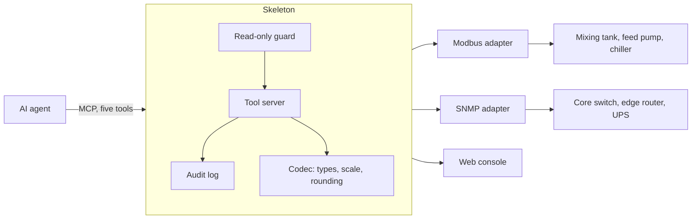

# Seance

[](https://github.com/minsmseo/seance/actions/workflows/tests.yml)
[](LICENSE)

**Ask the old machines what they are doing.**

Seance is a skeleton for read-only MCP servers that sit in front of legacy device protocols. It gives an AI agent five tools and nothing else. Two apps are built on it: a Modbus factory line and SNMP network gear.

Built for [Kiroween 2026](https://kiroween.devpost.com), Skeleton Crew category.

<!-- Add after the console redesign:

-->

## Why

Factory equipment and network gear speak protocols from the seventies and eighties. Ask a Modbus device a question and it answers `394`. Whether that is a temperature, what unit it uses and whether to divide it by ten is written in a manual somewhere.

Agents are good at reading and summarising, and these machines are full of things worth reading. Nobody wants an agent that can also write to a pump. Seance turns "read one value over an old protocol" into a small, safe set of tools, so supporting a new protocol is a matter of writing one adapter.

## What an agent sees

| Tool | What it does |
|---|---|
| `list_devices` | Names and descriptions of the devices |
| `list_points` | The points of one device, with data type and unit |
| `read_point` | One value, with unit and timestamp |
| `read_points` | Several values from one device |
| `device_health` | `ok`, `degraded` or `unreachable` |

A read comes back ready to use:

```json
{ "device": "core_switch", "point": "port3_status",
  "value": "down", "raw": 2, "unit": "state",
  "timestamp": "2026-11-25T11:28:54.123456+00:00" }
```

There is no sixth tool. Ask the agent to switch a pump off and it declines, because nothing it has can write.

## How it fits together



The skeleton knows nothing about any protocol and imports no protocol library. A test enforces that.

An app adds four things:

1. a simulator, so the app runs with no hardware
2. an adapter that reads one value
3. an address parser
4. a `devices.yaml` that names the points

## Read-only, in three places

- **Guard.** Anything that is not one of the five tools is rejected before its arguments are looked at.
- **Adapters.** The Modbus adapter only sends read function codes 1 to 4. The SNMP adapter only imports `get_cmd`.
- **Tests.** Property tests check that for any tool call and any arguments, the simulators never see a write request.

Every call, including a rejected one, leaves exactly one entry in the audit log.

## Run it

You need Python 3.12 and [uv](https://docs.astral.sh/uv/).

```bash
git clone https://github.com/minsmseo/seance
cd seance
uv sync
```

**Modbus factory line**

```bash
uv run python -m apps.modbus
```

**SNMP network gear**

```bash
SEANCE_CONSOLE_PORT=8090 uv run python -m apps.snmp
```

Each command starts the simulator, the MCP server on stdio and the web console. The console is at `http://127.0.0.1:8080` unless you set `SEANCE_CONSOLE_PORT`. See [apps/modbus/README.md](apps/modbus/README.md) and [apps/snmp/README.md](apps/snmp/README.md) for the points and the environment variables.

## Use it from an agent

The repository ships a workspace MCP config for Kiro at `.kiro/settings/mcp.json` with two servers, `seance-modbus` and `seance-snmp`. Open the folder in Kiro and ask:

- What is the mixing tank temperature right now?
- Which port on the core switch is down?
- Give me a one-paragraph status report of the factory line and the network gear.

Any MCP client works. The command is `uv run python -m apps.modbus` or `uv run python -m apps.snmp`, run from the repository root.

## Add a protocol

1. Create `apps/<name>/` with `simulator.py`, `adapter.py`, `address.py`, `devices.yaml` and `__main__.py`.
2. Implement `ProtocolAdapter` in `adapter.py`: `connect`, `close`, `read` and `health`. `read` returns raw bytes for one point. Raise `AdapterReadError` with a plain sentence when a read fails.
3. Describe the devices in `devices.yaml`. The skeleton handles data types, scaling, units, decimals and labels.
4. Start the server from `__main__.py` the way the two existing apps do.

The SNMP app was the second one built. It needed two additions to the skeleton, a 64-bit counter type and value labels, and both are generic.

## Layout

```
skeleton/seance/      tool server, guard, audit log, codec, config, console
skeleton/tests/
apps/modbus/          simulator, adapter, address parser, devices.yaml
apps/snmp/            simulator, adapter, address parser, devices.yaml
.kiro/steering/       product, tech, structure and design rules
.kiro/specs/          skeleton-core, app-modbus, app-snmp, console-redesign
.kiro/settings/       workspace MCP config
```

## Tests

```bash
uv run ruff check .
uv run pytest
```

The suite has about 490 tests, including more than twenty correctness properties written with Hypothesis. It runs on Ubuntu in GitHub Actions on every push.

## Built with Kiro

Everything here was built in Kiro with spec-driven development. The `.kiro` folder is part of the repository on purpose.

- **Steering** sets the product rules, the stack, the layout and the design language. One steering line about writes to real equipment shows up in the agent's refusals.
- **Specs** cover the skeleton and each app: requirements, design and tasks.
- **Correctness properties** from the designs became Hypothesis tests.
- **MCP** closes the loop. The IDE that wrote the servers is also the client that talks to them.

## Known limitations

- The devices are simulators. Seance has not been run against real hardware.
- A device that hangs holds one worker until its timeout. The server runs at most 8 reads at once.
- SNMP support is v2c with community strings. In the simulator the community selects the device. Real gear is addressed by host and port, with the community kept secret.
- The suite is verified on Linux. On Windows, run the apps and tests under WSL.

## License

[MIT](LICENSE)
